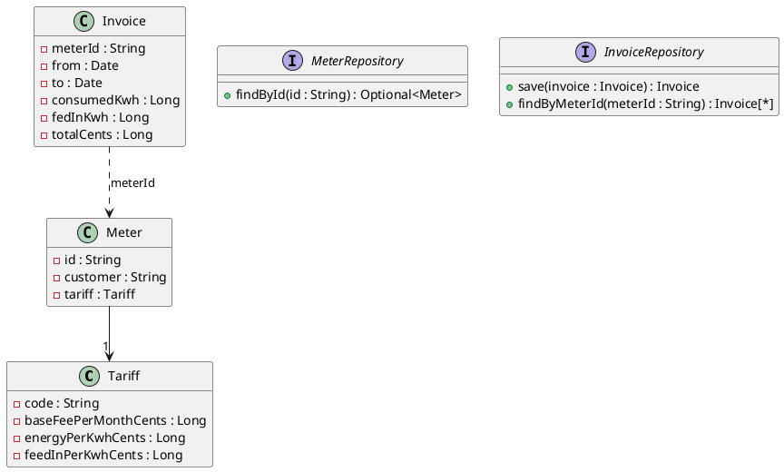

Diese mittlere Probeprüfung dauert **180 Minuten**: zwei unabhängige Aufgaben zu je 17 Punkten.
Du brauchst das Service-Modul (Einheiten 1–10, besonders 9 und 10: Spring-Service und seine
Tests) für Aufgabe B und das REST-Modul (Einheiten 1–11, besonders 3: Parameter) für Aufgabe C.
Der Ablauf steht in [So läuft eine Probeprüfung](/pruefungen/ablauf).

| Aufgabe | Thema | Punkte | Zeit |
|---|---|---|---|
| B | Business-Service: Energie-Abrechnung | 17 | 90 min |
| C | REST-API: Sensorwerte | 17 | 90 min |

Beide Aufgaben bearbeitest du in einem Projekt: Aufgabe B im Subprojekt
`Aufgabe2_BusinessService`, Aufgabe C in `Aufgabe3_RestfulApi`. Bei jedem Push laufen deine
eigenen Tests; schlagen sie fehl, siehst du das an der Abgabe.

## Aufgabe B – Energie-Abrechnung (17 Punkte)

Ein Energieversorger rechnet Haushalte mit Photovoltaik-Anlage ab: Jeder Zähler misst den Strom,
den der Haushalt **bezieht**, und den Strom, den er ins Netz **einspeist**. Du schreibst den
Spring-Service, der aus zwei Zählerständen eine Rechnung erstellt und speichert.



Die beiden Repositories sind Datenzugriffsschnittstellen. Damit der Spring-Kontext startet
(Test `contextLoads` im Seed-Projekt), gibt es für jede eine einfache In-Memory-Implementierung
mit `@Repository`. In den Tests des Service ersetzt du sie durch Mocks.

### Regeln

- Bezug und Einspeisung sind die **Differenz der Zählerstände** zwischen Anfang und Ende.
- Die **Grundgebühr** fällt für jeden angefangenen Monat des Zeitraums an, mindestens für einen
  Monat (15.1.–15.2. ist ein Monat, 15.1.–16.2. sind zwei).
- **Energiepreis** = bezogene kWh × Preis pro kWh.
- **Einspeisung** wird gutgeschrieben: eingespeiste kWh × Vergütung pro kWh. Die Gutschrift
  senkt den Energiepreis höchstens auf 0 – die Grundgebühr zahlt man immer.
- Gesamtbetrag = Grundgebühr + Energiepreis − Gutschrift. Alle Beträge in Cent.

### Der Service

```text
@Service
klasse BillingService {
  BillingService(MeterRepository meters, InvoiceRepository invoices)

  ## Rechnung aus zwei Zählerständen erstellen, als Invoice speichern und zurückgeben
  InvoiceDto bill(BillingRequestDto request)

  ## Alle Rechnungen eines Zählers, älteste zuerst
  Liste<InvoiceSummaryDto> invoicesFor(String meterId)
}
```

| DTO | Inhalt |
|---|---|
| `BillingRequestDto` | `meterId`, `start` und `end` als `ReadingDto` |
| `ReadingDto` | `date`, `consumptionKwh` (Bezugszähler), `feedInKwh` (Einspeisezähler) |
| `InvoiceDto` | `meterId`, `customer`, `from`, `to`, `consumedKwh`, `fedInKwh`, `baseFeeCents`, `energyCents`, `feedInCreditCents`, `totalCents` |
| `InvoiceSummaryDto` | `from`, `to`, `totalCents` |

Fehlerfälle, jeweils mit eigener Exception – in keinem Fall wird eine Rechnung gespeichert:

- Zähler unbekannt: `MeterNotFoundException`
- Ein Zählerstand ist am Ende kleiner als am Anfang: `MeterRunsBackwardsException` – die
  Meldung nennt den Zähler (`consumption` oder `feed-in`)
- Das Enddatum liegt nicht nach dem Anfangsdatum: `InvalidPeriodException`

Packages: Datenklassen in `businessservice.model`, Repositories in `businessservice.persistence`,
Service, DTOs und Exceptions in `businessservice.service`.

### Tests

Teste den Service mit `@ExtendWith(MockitoExtension.class)` und Mocks für beide Repositories:
die Rechnung an den Monatsgrenzen, den Gutschrift-Deckel, einen Zeitraum ohne Verbrauch, jeden
Fehlerfall. Prüfe mit `verify` und einem `ArgumentCaptor`, **was** gespeichert wird – und dass bei
einem Fehler nichts gespeichert wird.

## Aufgabe C – Sensorwerte-API (17 Punkte)

Eine Wetterstation liefert alle 15 Minuten Temperatur und Luftfeuchtigkeit. Die REST-API stellt
die Messwerte eines Sensors bereit. Alle Endpunkte liegen unter
**`/api/sensors/{sensorId}`**. Controller und Fehlerbehandlung gehören ins Package
`restfulapi.presentation`, der Service und die Datenklassen nach `restfulapi.service`.

### Schnittstellenobjekte

```json
// measurementView
{ "id": 1, "sensor-id": "WS-01", "timestamp": "2026-11-02T08:00:00", "temperature": 12.5, "humidity": 81 }
```

```json
// measurementCreate
{ "timestamp": "2026-11-02T08:00:00", "temperature": 12.5, "humidity": 81 }
```

```json
// dailyStatisticsView
{ "date": "2026-11-02", "count": 96, "min-temperature": 4.5, "max-temperature": 13.0, "avg-temperature": 8.7 }
```

Regeln für `measurementCreate`: `timestamp` liegt nicht in der Zukunft, `temperature` liegt
zwischen −50,0 und 60,0, `humidity` zwischen 0 und 100. Alle Felder sind Pflicht.

### Endpunkte

| Was | Parameter | Antwort |
|---|---|---|
| Messwerte eines Zeitraums | `from`, `to` (Datum mit Uhrzeit, ISO), beide optional | `200` mit Liste – auch leer |
| Die neuesten Messwerte | `count`, Standard 10, erlaubt 1 bis 100 | `200`, neueste zuerst |
| Ein Messwert | Id im Pfad | `200` oder `404` |
| Messwert melden | `measurementCreate` | `201` mit `Location` |
| Tagesstatistik | `date` (ISO-Datum), Pflicht | `200`, oder `204`, wenn es an dem Tag keine Messwerte gibt |

Regeln für die Parameter:

- Fehlen `from` und `to`, entscheidet der Service (die letzten 24 Stunden) – der Controller gibt
  dann `null` weiter.
- Sind beide angegeben, darf `to` nicht vor `from` liegen und der Zeitraum höchstens **31 Tage**
  lang sein. Sonst antwortet die API mit `400` und einem `ProblemDetail`, das den Grund nennt.
- Ein `count` außerhalb von 1 bis 100, ein falsches Datumsformat oder ein fehlendes `date`
  ergeben ebenfalls `400`.

### Der Service

Lege einen `SensorService` mit `@Service` als **Stub** an. Er meldet einen unbekannten Sensor
und einen unbekannten Messwert mit eigenen Exceptions (`404`). Jeder Fehler, den du selbst
behandelst, bekommt ein `ProblemDetail` mit einer eindeutigen Referenz (`reference`) und wird
mit ihr geloggt.

### Tests

Teste mit `@WebMvcTest` und einem `@MockitoBean` des Service. Gefordert ist eine vollständige
Teststrategie:

- **Good Cases:** jeder Endpunkt mit gültigen Parametern; prüfe, mit welchen Werten der Service
  aufgerufen wird.
- **Edge Cases:** leere Liste, genau 31 Tage, `count` 1 und 100, Standardwert von `count`, Tag ohne
  Messwerte (`204`).
- **Exception Cases:** `to` vor `from`, 31 Tage und eine Minute, `count` 0 und 101, falsches
  Datumsformat, ungültiger Messwert, unbekannter Sensor. Bei ungültigen Parametern darf der
  Service gar nicht aufgerufen werden.

:::pruefung
Bei jedem Push läuft `./gradlew test`. Ob deine Tests grün sind, siehst du im Repository; die
Beurteilung macht deine Lehrkraft nach den Kriterien unten.
:::
