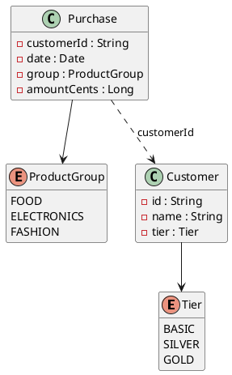

Diese mittlere Probeprüfung dauert **180 Minuten**: zwei unabhängige Aufgaben zu je 17 Punkten.
Du brauchst das Service-Modul (besonders Einheit 8: Aufteilen, und 10: Mocks) für Aufgabe B und
das REST-Modul (Validierung, Ändern/Löschen, `@JsonTest`) für Aufgabe C. Der Ablauf steht in
[So läuft eine Probeprüfung](/pruefungen/ablauf).

| Aufgabe | Thema | Punkte | Zeit |
|---|---|---|---|
| B | Business-Service: Bonusprogramm | 17 | 90 min |
| C | REST-API: Feriencamp-Anmeldungen | 17 | 90 min |

Beide Aufgaben bearbeitest du in einem Projekt: Aufgabe B im Subprojekt
`Aufgabe2_BusinessService`, Aufgabe C in `Aufgabe3_RestfulApi`. Bei jedem Push laufen deine
eigenen Tests; schlagen sie fehl, siehst du das an der Abgabe.

## Aufgabe B – Bonusprogramm (17 Punkte)

Eine Handelskette belohnt Einkäufe mit Bonuspunkten. Wer genug Punkte sammelt, steigt in eine
höhere Kundenstufe auf. Die Lösung besteht aus **zwei Klassen**, die zusammenarbeiten: Ein
`BonusCalculator` berechnet die Punkte eines Einkaufs, ein `TierService` entscheidet über die
Kundenstufe und bekommt den Rechner im Konstruktor.



### Punkte (BonusCalculator)

- Es zählen nur **volle Euro** des Einkaufs (49,99 € sind 49 €).
- Pro Euro gibt es bei `FOOD` 1 Punkt, bei `ELECTRONICS` 2 und bei `FASHION` 3 Punkte.
- Die Kundenstufe vervielfacht die Punkte: `BASIC` × 1, `SILVER` × 1,5 (abgerundet), `GOLD` × 2.
- Ein Einkauf mit 0 Cent oder weniger wird schon beim Erzeugen abgelehnt.

### Stufen (TierService)

- Die Punkte eines Kunden sind die Summe seiner Einkäufe der **letzten 12 Monate** – von heute
  minus ein Jahr bis heute, beide Tage eingeschlossen –, berechnet mit seiner **aktuellen**
  Stufe. Einkäufe nach heute werden ignoriert.
- Ab **2000** Punkten erreicht man `SILVER`, ab **5000** `GOLD`. Wer schon höher ist, bleibt dort:
  Wenige Punkte allein führen zu keinem Abstieg.
- Wer seit **mehr als zwei Jahren** nichts gekauft hat (letzter Einkauf vor heute minus zwei
  Jahre), fällt auf `BASIC` zurück.

```text
klasse BonusCalculator {
  Long points(Purchase purchase, Tier tier)
}

klasse TierService {
  TierService(BonusCalculator calculator)

  Long pointsOfLastYear(Customer customer, Liste<Purchase> purchases, Datum today)
  Tier newTier(Customer customer, Liste<Purchase> purchases, Datum today)

  ## Neue Stufe aller Kunden: Stufe -> sortierte Kunden-Ids; alle drei Stufen sind Schlüssel
  Map<Tier, Liste<String>> reviewTiers(Liste<Customer> customers, Liste<Purchase> purchases, Datum today)
}
```

Gehört in `reviewTiers` ein Einkauf zu keinem der übergebenen Kunden, wirft der Service eine
`UnknownCustomerException`. Lege die Datenklassen und Enums im Package `businessservice.model`,
die beiden Klassen in `businessservice.service` an. Ohne Spring – nur Java und Tests.

### Tests

- `BonusCalculator`: mit reinen AssertJ-Tests, parametrisiert für Warengruppen, Stufen und
  Rundung.
- `TierService`: mit Mockito, **der Rechner ist ein `@Mock`**. So prüfst du die Stufenregeln
  unabhängig von den Punkteregeln: Schwellen 1999/2000 und 4999/5000, kein Abstieg, genau zwei
  Jahre und einen Tag mehr, alle drei Stufen im Ergebnis. Prüfe mit `verify`, dass der Rechner
  mit der aktuellen Stufe aufgerufen wird – und für alte Einkäufe gar nicht.

## Aufgabe C – Feriencamp-Anmeldungen (17 Punkte)

Ein Jugendverein bietet Feriencamps an. Eltern melden ihre Kinder über eine REST-API an. Alle
Endpunkte liegen unter `/api/camps` und `/api/registrations`. Controller und Fehlerbehandlung
gehören ins Package `restfulapi.presentation`, der Service und die Datenklassen nach
`restfulapi.service`.

### Schnittstellenobjekte

```json
// campView
{
  "id": "SOMMER-26-1", "title": "Abenteuercamp Ossiacher See",
  "start": "2027-07-12", "end": "2027-07-18",
  "min-age": 8, "max-age": 12, "capacity": 40, "registered": 39
}
```

```json
// registrationCreate
{
  "child": { "first-name": "Mia", "last-name": "Berger", "birth-date": "2016-04-12" },
  "guardian": { "name": "Lena Berger", "email": "lena.berger@example.com", "phone": "+43 664 1234567" },
  "notes": "Vegetarisch"
}
```

```json
// registrationView
{
  "id": 17,
  "camp-id": "SOMMER-26-1",
  "child": { "first-name": "Mia", "last-name": "Berger", "birth-date": "2016-04-12" },
  "guardian": { "name": "Lena Berger", "email": "lena.berger@example.com", "phone": "+43 664 1234567" },
  "notes": "Vegetarisch",
  "registered-at": "2026-10-20T18:30:00"
}
```

```json
// registrationUpdate – nur die Felder, die sich ändern
{ "guardian-phone": "+43 660 7654321" }
```

Regeln für die Eingaben:

- `child` und `guardian` sind Pflicht und werden **mit allen ihren Feldern** geprüft:
  `first-name`, `last-name` und `name` nicht leer, `birth-date` in der Vergangenheit, `email` eine
  gültige E-Mail-Adresse, `phone` aus Ziffern und Leerzeichen mit optionalem `+` am Anfang,
  6 bis 20 Zeichen.
- `notes` ist optional, höchstens 500 Zeichen.
- `registrationUpdate`: Jedes Feld ist optional; ein fehlendes Feld bleibt unverändert. Ist es
  angegeben, gelten dieselben Regeln wie oben.

Eingehende Objekte sind Commands (`RegistrationCreateCmd`, `RegistrationUpdateCmd`) mit den
verschachtelten Objekten `ChildDto` und `GuardianDto`; ausgehende heißen `CampView` und
`RegistrationView`.

### Endpunkte

- Ein Camp lesen
- Die Anmeldungen eines Camps lesen
- Ein Kind für ein Camp anmelden – `201` mit `Location` auf die neue Anmeldung
- Eine Anmeldung lesen
- Eine Anmeldung teilweise ändern (Kontaktdaten, Anmerkungen)
- Eine Anmeldung stornieren

### Der Service

Lege einen `CampService` mit `@Service` als **Stub** an. Er meldet mit eigenen Exceptions:

| Fall | Status |
|---|---|
| Camp oder Anmeldung nicht gefunden | `404` |
| Camp ist voll („camp SOMMER-26-1 is full (40 places)“) | `409` |
| Kind ist zu Campbeginn zu jung oder zu alt | `409` |
| Kind ist für dieses Camp schon angemeldet | `409` |
| Stornieren weniger als 7 Tage vor Campbeginn | `409` |

Jeder dieser Fehler wird als `ProblemDetail` mit einer eindeutigen Referenz (`reference`)
beantwortet und mit ihr geloggt. Bei Validierungsfehlern nennt `detail` jedes fehlerhafte Feld
mit seinem Pfad, etwa `child.birthDate` oder `guardian.email`.

### Tests

- Teste den Controller mit `@WebMvcTest` und einem `@MockitoBean` des Service: jeder Endpunkt
  mit Good, Edge und Exception Cases, besonders Fehler in den **verschachtelten** Objekten und
  jeder `409`-Fall. Bei ungültigen Eingaben darf der Service nicht aufgerufen werden.
- Prüfe `registrationView` zusätzlich mit einem **`@JsonTest`**: Das JSON muss der Beispieldatei
  `registration.json` (das Beispiel oben, in `src/test/resources`) entsprechen, und ein
  `registrationUpdate` mit nur einem Feld lässt die anderen auf `null`.

:::pruefung
Bei jedem Push läuft `./gradlew test`. Ob deine Tests grün sind, siehst du im Repository; die
Beurteilung macht deine Lehrkraft nach den Kriterien unten.
:::
