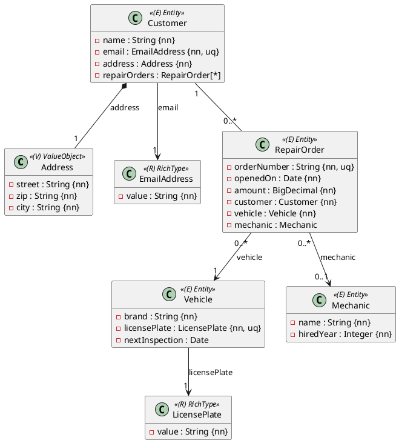
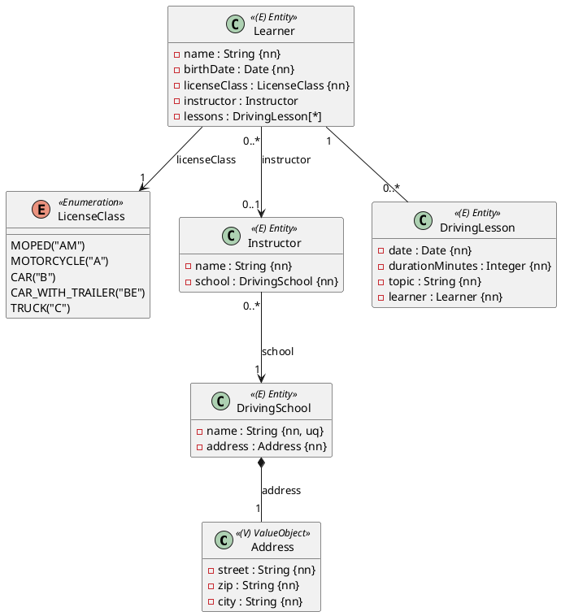

Die erste volle Probeprüfung: **vier Aufgaben, 300 Minuten, je 17 Punkte** – Aufbau wie beim
Haupttermin, **beide OR-Mapping-Aufgaben sind zu lösen**. Der Zeitplan-Vorschlag und die
Vorgehensweise stehen in [So läuft eine Probeprüfung](/pruefungen/ablauf).

| Aufgabe | Thema | Subprojekt | Punkte | Zeit |
|---|---|---|---|---|
| A1 | OR-Mapping: Autowerkstatt | `Aufgabe1_ORMapping` (`ormapping1`) | 17 | 70 min |
| A2 | OR-Mapping: Fahrschule (Besonderheit: Enum-Codes) | `Aufgabe2_ORMapping` (`ormapping2`) | 17 | 80 min |
| B | Business-Service: Parkhaus | `Aufgabe3_BusinessService` | 17 | 75 min |
| C | REST-API: Produktkatalog | `Aufgabe4_RestfulApi` | 17 | 75 min |

Das Projekt hat den Aufbau des Haupttermins: zwei OR-Mapping-Subprojekte mit den Packages
`ormapping1` und `ormapping2`, danach Service und REST-API.

## Aufgabe A1 – Autowerkstatt (17 Punkte)

Eine Autowerkstatt verwaltet ihre **Kunden**, deren **Fahrzeuge**, die **Mechaniker** und die
**Werkstattaufträge**. Jeder Auftrag gehört zu genau einem Kunden und genau einem Fahrzeug; ein
Mechaniker wird erst später zugeteilt.



### Regeln

- **Längen:** `name` (Kunde und Mechaniker) höchstens 80 Zeichen, `email` 120, `brand` 40,
  `orderNumber` 12, `licensePlate` 12. Die Adresse wird **eingebettet** gespeichert (`street`
  höchstens 60, `zip` 5, `city` 40 Zeichen, alle Pflicht).
- `amount` hat Precision 8, Scale 2. `nextInspection` ist das Datum der nächsten
  §57a-Begutachtung („Pickerl“) und darf fehlen.
- `EmailAddress` und `LicensePlate` sind **Records** mit der Komponente `value`, die ungültige
  Werte im Konstruktor ablehnen (`IllegalArgumentException`). Ein Kennzeichen besteht aus ein
  oder zwei Großbuchstaben, Bindestrich und 3 bis 6 Großbuchstaben oder Ziffern (`W-12345A`).
  Beide werden über einen **null-sicheren `AttributeConverter`** mit `autoApply = true` als String
  gespeichert.
- **Benannte Constraints:** `uk_vehicle_license_plate` und `uk_repair_order_number` (eindeutig);
  Fremdschlüssel `fk_repair_order_customer`, `fk_repair_order_vehicle` und
  `fk_repair_order_mechanic` in den Spalten `customer_id`, `vehicle_id` und `mechanic_id`.
- Kunde ↔ Aufträge ist **bidirektional**: `Customer.addRepairOrder` / `removeRepairOrder` setzen
  beide Seiten, `getRepairOrders()` liefert eine unveränderliche Liste. Gespeichert wird über den
  Kunden (`cascade = PERSIST`); Fahrzeug und Mechaniker sind **vorher gespeichert**.

### Implementierung

Entities im Package `ormapping1.model`, Repositories in `ormapping1.persistence`
(`CustomerRepository`, `VehicleRepository`, `MechanicRepository`, `RepairOrderRepository`, alle
`JpaRepository<…, Long>`). Jedes Entity erbt von `AbstractPersistable<Long>` und hat einen
`protected` No-Args-Konstruktor, einen öffentlichen Konstruktor ohne `id` und Getter. Dazu zwei
abgeleitete Queries:

```java
// VehicleRepository
Optional<Vehicle> findByLicensePlate(LicensePlate licensePlate);

// RepairOrderRepository – beide Tage eingeschlossen
List<RepairOrder> findByCustomerAndOpenedOnBetween(Customer customer, LocalDate from, LocalDate to);
```

### Tests

Schreibe `@DataJpaTest`s, die einen Kunden mit Aufträgen über die Kaskade speichern und nach
`flush()` und `clear()` vollständig wieder lesen. Prüfe außerdem die Eindeutigkeit von E-Mail und
Kennzeichen, einen Auftrag ohne Kunden, die Hilfsmethoden und beide Queries – auch an den
Datumsgrenzen.

## Aufgabe A2 – Fahrschule (17 Punkte)

Eine Fahrschule verwaltet ihre **Fahrlehrer**, die **Fahrschülerinnen und Fahrschüler** und deren
**Fahrstunden**. Die Besonderheit dieser Aufgabe: Die **Führerscheinklasse** ist ein Enum, das als
offizieller Code gespeichert wird.



### Regeln

- **Längen:** `name` überall höchstens 80 Zeichen, `topic` 80; der Name der Fahrschule ist
  eindeutig. `durationMinutes` ist größer als 0.
- **Enum-Codes:** `LicenseClass` hat `String getCode()` und `static LicenseClass fromCode(String)`
  (wirft `IllegalArgumentException` für unbekannte Codes). Der `LicenseClassConverter`
  implementiert `AttributeConverter<LicenseClass, String>` mit `autoApply = true` und ist in
  **beiden Richtungen null-sicher**. Die Spalte `license_class` hat Länge 2 – in der Datenbank
  steht `BE`, nicht `CAR_WITH_TRAILER`.
- **Fremdschlüssel:** `fk_instructor_school`, `fk_learner_instructor` und
  `fk_driving_lesson_learner`. Ein Fahrschüler darf (noch) keinen Fahrlehrer haben.
- Fahrschüler ↔ Fahrstunden ist **bidirektional** mit `addLesson` / `removeLesson` und
  unveränderlichem `getLessons()`; gespeichert wird über den Fahrschüler (`cascade = PERSIST`).
  Der Fahrlehrer wird mit `assignInstructor(instructor)` zugeteilt.

### Implementierung

Entities in `ormapping2.model`, Repositories in `ormapping2.persistence`; Konstruktoren und Getter
wie in A1. Gefordert sind diese Abfragen:

```java
// LearnerRepository
List<Learner> findByLicenseClass(LicenseClass licenseClass);
List<Learner> findByInstructorIsNull();

// DrivingLessonRepository
@Query("select count(l) from DrivingLesson l where l.learner.instructor = :instructor")
long countByInstructor(@Param("instructor") Instructor instructor);

@Query("select sum(l.durationMinutes) from DrivingLesson l where l.learner = :learner")
Long totalMinutes(@Param("learner") Learner learner);   // ohne Fahrstunden: null
```

### Tests

Prüfe mit `@DataJpaTest`, dass **jede** Führerscheinklasse als ihr Code in der Datenbank steht
(parametrisiert, mit einer nativen Abfrage der Spalte), dass der Converter mit `null` umgehen kann,
dass ein Fahrschüler mit Fahrstunden vollständig zurückkommt und dass alle vier Abfragen stimmen –
auch `totalMinutes` ohne Fahrstunden.

## Aufgabe B – Parkhaus (17 Punkte)

Die Angabe ist **Aufgabe B aus
[Probeprüfung 5 – Parkhaus und Projekt-Tasks](/pruefungen/uebungen/parkhaus-und-projekt-tasks)**:
Tarif mit Halbstunden-Blöcken, Nachttarif, Tagesdeckel und Dauerparkern, `ParkingFeeService` mit
`feeCents` und `revenuePerDay`. Bearbeite sie hier im Subprojekt `Aufgabe3_BusinessService`; die
Packages (`businessservice.model`, `businessservice.service`) bleiben gleich.

## Aufgabe C – Produktkatalog (17 Punkte)

Die Angabe ist **Aufgabe C aus
[Probeprüfung 6 – Versandkosten und Produktkatalog](/pruefungen/uebungen/versand-und-produktkatalog)**:
Hypermedia-API mit Seiten (`PagedModel`), Links `self`, `category` und `products`, Anlegen eines
Produkts in einer Kategorie. Bearbeite sie hier im Subprojekt `Aufgabe4_RestfulApi`.

:::merke
Hast du B oder C schon in der mittleren Probeprüfung gelöst, löse sie trotzdem **neu und in der
Zeit** – genau das übt die volle Prüfung: vier Aufgaben in 300 Minuten.
:::

## Abgabe und Feedback

Diese Prüfung wird von der Lehrkraft bewertet: Feedback kommt direkt ins Repository. Bei jedem Push
läuft `./gradlew test` für alle vier Subprojekte – deine eigenen Tests müssen grün sein. Schätze
dich nach der Abgabe selbst ein (unten).
