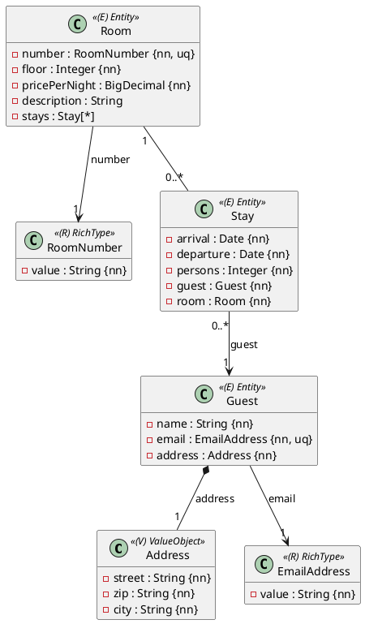
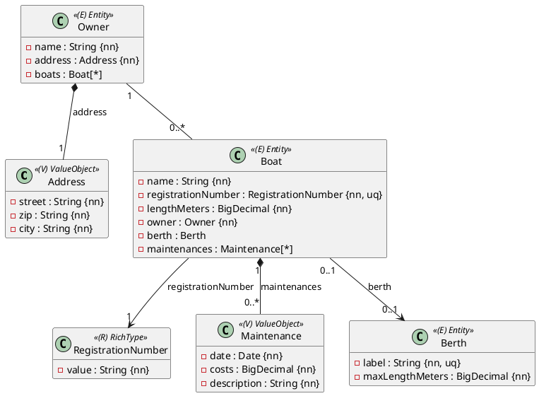

Die zweite volle Probeprüfung: **vier Aufgaben, 300 Minuten, je 17 Punkte** – **beide
OR-Mapping-Aufgaben sind zu lösen**. Zeitplan und Vorgehen:
[So läuft eine Probeprüfung](/pruefungen/ablauf).

| Aufgabe | Thema | Subprojekt | Punkte | Zeit |
|---|---|---|---|---|
| A1 | OR-Mapping: Pension Seeblick | `Aufgabe1_ORMapping` (`ormapping1`) | 17 | 70 min |
| A2 | OR-Mapping: Bootshafen (Besonderheit: 1:1 und Element-Collection) | `Aufgabe2_ORMapping` (`ormapping2`) | 17 | 80 min |
| B | Business-Service: Versandkosten | `Aufgabe3_BusinessService` | 17 | 75 min |
| C | REST-API: Projekt-Tasks | `Aufgabe4_RestfulApi` | 17 | 75 min |

## Aufgabe A1 – Pension Seeblick (17 Punkte)

Die Pension Seeblick verwaltet ihre **Gäste**, ihre **Zimmer** und die **Aufenthalte**. Jeder
Aufenthalt gehört zu genau einem Gast und genau einem Zimmer.



### Regeln

- **Längen:** `name` höchstens 80 Zeichen, `email` 120, `description` 200 (optional); die Adresse
  wird eingebettet gespeichert (`street` 60, `zip` 5, `city` 40, alle Pflicht).
- `pricePerNight` hat Precision 6, Scale 2. `persons` ist mindestens 1.
- `RoomNumber` ist ein **Record** mit der Komponente `value` im Format Gebäude-Buchstabe,
  Bindestrich, drei Ziffern (`D-101`), gespeichert über einen null-sicheren Converter in der
  Spalte `number` (Länge 5). `EmailAddress` wie gewohnt.
- Ein Aufenthalt, dessen Abreise nicht nach der Anreise liegt, wird schon im Konstruktor
  abgelehnt (`IllegalArgumentException`).
- **Benannte Constraints:** `uk_room_number` (eindeutige Zimmernummer), Fremdschlüssel
  `fk_stay_guest` und `fk_stay_room`.
- Zimmer ↔ Aufenthalte ist **bidirektional**: `Room.addStay` / `removeStay` setzen beide Seiten,
  `getStays()` ist unveränderlich. Gespeichert wird über das Zimmer (`cascade = PERSIST`); die
  Gäste sind **vorher gespeichert**.

:::achtung `from` und `to`
Die Spalten heißen `arrival` und `departure`: `from` und `to` sind in H2 reservierte Wörter und
scheitern als Spaltennamen.
:::

### Implementierung

Entities in `ormapping1.model`, Repositories in `ormapping1.persistence`; jedes Entity erbt von
`AbstractPersistable<Long>`, mit `protected` No-Args-Konstruktor, öffentlichem Konstruktor ohne
`id` und Gettern. Gefordert sind diese abgeleiteten Queries:

```java
// RoomRepository
Optional<Room> findByNumber(RoomNumber number);
List<Room> findByPricePerNightLessThanEqualOrderByPricePerNightAsc(BigDecimal maxPrice);

// StayRepository
List<Stay> findByRoomAndDepartureAfter(Room room, LocalDate date);   // laufende und künftige Aufenthalte
List<Stay> findByGuestOrderByArrivalAsc(Guest guest);
```

### Tests

Schreibe `@DataJpaTest`s, die ein Zimmer mit Aufenthalten über die Kaskade speichern und nach
`flush()` und `clear()` vollständig wieder lesen. Prüfe außerdem die eindeutige Zimmernummer, einen
Aufenthalt ohne Zimmer, die Regeln für Personen und Datum, die Hilfsmethoden und alle vier
Queries – auch, dass eine Abreise genau am Stichtag nicht „danach“ ist.

## Aufgabe A2 – Bootshafen (17 Punkte)

Ein Bootshafen verwaltet **Eigner**, ihre **Boote** und die **Liegeplätze**. Die Besonderheiten
dieser Aufgabe: Jeder Liegeplatz beherbergt **höchstens ein Boot** (1:1), und die
**Wartungshistorie** eines Boots ist eine Sammlung von Wertobjekten ohne eigene Entity.



### Regeln

- **Längen:** `name` beim Eigner höchstens 80 Zeichen, beim Boot 60; `label` 10 (eindeutig),
  `description` 200, `registrationNumber` 12. `lengthMeters` und `maxLengthMeters` haben
  Precision 4, Scale 2, `costs` Precision 8, Scale 2.
- `RegistrationNumber` ist ein **Record** im Format Ländercode, Bindestrich, 4 bis 6 Ziffern
  (`AT-123456`), eindeutig, über einen null-sicheren Converter gespeichert.
- **1:1 Boot → Liegeplatz:** `@OneToOne` auf der **Bootseite** (der Liegeplatz kennt sein Boot
  nicht), Spalte `berth_id`, **eindeutig**, Fremdschlüssel `fk_boat_berth`. Ein Boot darf (noch)
  keinen Liegeplatz haben. `assignBerth(berth)` lehnt ein Boot ab, das länger als der Liegeplatz
  ist (`IllegalArgumentException`); genau gleich lang passt.
- **Wartungshistorie:** `Maintenance` ist ein **Record** und eine `@ElementCollection` in der Tabelle
  **`boat_maintenances`** mit der Spalte `boat_id` (Fremdschlüssel `fk_boat_maintenances_boat`) –
  ohne eigene Entity und ohne eigenes Repository. Einträge kommen über `addMaintenance`,
  `getMaintenances()` ist unveränderlich.
- Eigner ↔ Boote ist **bidirektional** mit `Owner.addBoat`; gespeichert wird über den Eigner
  (`cascade = PERSIST`), Fremdschlüssel `fk_boat_owner`. Die Liegeplätze sind **vorher
  gespeichert**.

### Implementierung

Entities in `ormapping2.model`, Repositories `OwnerRepository`, `BerthRepository` und
`BoatRepository` in `ormapping2.persistence`; Konstruktoren und Getter wie in A1. Gefordert sind:

```java
// BoatRepository
Optional<Boat> findByBerth(Berth berth);
List<Boat> findByBerthIsNull();

@Query("select sum(m.costs) from Boat b join b.maintenances m where b = :boat")
BigDecimal totalMaintenanceCosts(@Param("boat") Boat boat);   // ohne Wartungen: null
```

### Tests

Prüfe mit `@DataJpaTest`, dass ein Boot mit Liegeplatz und Wartungen vollständig zurückkommt, dass
die Wartungen als Zeilen in `boat_maintenances` stehen, dass **zwei Boote am selben Liegeplatz**
abgelehnt werden, dass die Längenregel an ihrer Grenze stimmt und dass alle drei Abfragen – auch
die Summe ohne Wartungen – das Erwartete liefern.

## Aufgabe B – Versandkosten (17 Punkte)

Die Angabe ist **Aufgabe B aus
[Probeprüfung 6 – Versandkosten und Produktkatalog](/pruefungen/uebungen/versand-und-produktkatalog)**:
Zonentarif nach Gewichtsstufen, Sperrgut, Gratisgrenze und Zusammenfassung pro Zone über ein
gemocktes `OrderRepository`. Bearbeite sie hier im Subprojekt `Aufgabe3_BusinessService`; die
Packages bleiben gleich.

## Aufgabe C – Projekt-Tasks (17 Punkte)

Die Angabe ist **Aufgabe C aus
[Probeprüfung 5 – Parkhaus und Projekt-Tasks](/pruefungen/uebungen/parkhaus-und-projekt-tasks)**:
Projekte mit Tasks als Unterressource, Statuswechsel per PATCH, Konflikte als `409`, Fehler mit
Referenz. Bearbeite sie hier im Subprojekt `Aufgabe4_RestfulApi`.

:::merke
Hast du B oder C schon in der mittleren Probeprüfung gelöst, löse sie trotzdem **neu und in der
Zeit** – genau das übt die volle Prüfung: vier Aufgaben in 300 Minuten.
:::

## Abgabe und Feedback

Diese Prüfung wird von der Lehrkraft bewertet: Feedback kommt direkt ins Repository. Bei jedem Push
läuft `./gradlew test` für alle vier Subprojekte – deine eigenen Tests müssen grün sein. Schätze
dich nach der Abgabe selbst ein (unten).
