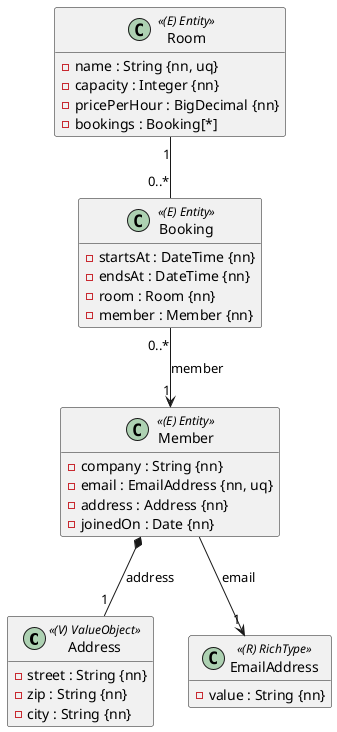
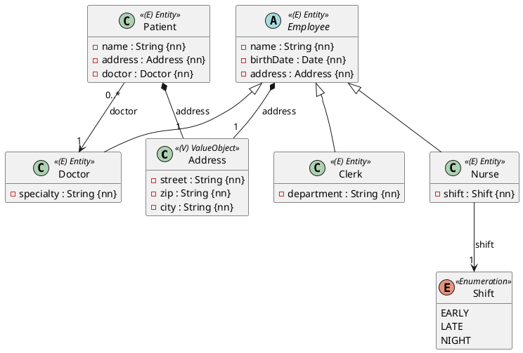

Die dritte volle Probeprüfung: **vier Aufgaben, 300 Minuten, je 17 Punkte** – **beide
OR-Mapping-Aufgaben sind zu lösen**. Zeitplan und Vorgehen:
[So läuft eine Probeprüfung](/pruefungen/ablauf).

| Aufgabe | Thema | Subprojekt | Punkte | Zeit |
|---|---|---|---|---|
| A1 | OR-Mapping: Coworking-Space | `Aufgabe1_ORMapping` (`ormapping1`) | 17 | 70 min |
| A2 | OR-Mapping: Arztpraxis (Besonderheit: Vererbung) | `Aufgabe2_ORMapping` (`ormapping2`) | 17 | 80 min |
| B | Business-Service: Energie-Abrechnung | `Aufgabe3_BusinessService` | 17 | 75 min |
| C | REST-API: Feriencamp-Anmeldungen | `Aufgabe4_RestfulApi` | 17 | 75 min |

## Aufgabe A1 – Coworking-Space (17 Punkte)

Ein Coworking-Space vermietet **Räume** stundenweise an seine **Mitglieder** (Firmen). Jede
**Buchung** gehört zu genau einem Raum und genau einem Mitglied.



### Regeln

- **Längen:** `company` höchstens 80 Zeichen, `email` 120, `name` des Raums 40 (eindeutig,
  Constraint `uk_room_name`); die Adresse wird eingebettet gespeichert (`street` 60, `zip` 5,
  `city` 40, alle Pflicht).
- `capacity` ist größer als 0, `pricePerHour` hat Precision 6, Scale 2.
- Eine Buchung, deren Ende nicht nach dem Beginn liegt, wird im Konstruktor abgelehnt
  (`IllegalArgumentException`). Die Spalten heißen `starts_at` und `ends_at` – `end` ist in H2
  reserviert.
- **Fremdschlüssel:** `fk_booking_room` und `fk_booking_member`.
- Raum ↔ Buchungen ist **bidirektional** mit `addBooking` / `removeBooking` und unveränderlichem
  `getBookings()`; gespeichert wird über den Raum (`cascade = PERSIST`), die Mitglieder sind
  **vorher gespeichert**.

### Implementierung

Entities in `ormapping1.model`, Repositories `MemberRepository`, `RoomRepository` und
`BookingRepository` in `ormapping1.persistence`; jedes Entity erbt von
`AbstractPersistable<Long>`, mit `protected` No-Args-Konstruktor, öffentlichem Konstruktor ohne
`id` und Gettern. Gefordert sind diese abgeleiteten Queries:

```java
// RoomRepository – Räume für mindestens so viele Personen, billigster zuerst
List<Room> findByCapacityGreaterThanEqualOrderByPricePerHourAsc(Integer persons);

// BookingRepository
List<Booking> findByMemberOrderByStartsAtAsc(Member member);

// Ist der Raum zwischen start und end irgendwann gebucht? Aufruf mit (room, end, start).
boolean existsByRoomAndStartsAtBeforeAndEndsAtAfter(Room room, LocalDateTime end, LocalDateTime start);
```

:::merke Zwei Zeiträume überschneiden sich …
… wenn jeder beginnt, bevor der andere endet. Eine Buchung bis 11:00 und eine ab 11:00
überschneiden sich also **nicht** – genau das prüft die dritte Query.
:::

### Tests

Schreibe `@DataJpaTest`s, die einen Raum mit Buchungen über die Kaskade speichern und nach
`flush()` und `clear()` wieder lesen. Prüfe den eindeutigen Raumnamen, die Regeln für Kapazität und
Zeiten, eine Buchung ohne Raum und alle drei Queries – die Überschneidung auch an den Rändern
(direkt davor und direkt danach).

## Aufgabe A2 – Arztpraxis (17 Punkte)

Das Personal einer Arztpraxis ist eine **Vererbungshierarchie** – das ist die Besonderheit dieser
Aufgabe. Ärztinnen und Ärzte, Pflegekräfte und Verwaltungsangestellte haben gemeinsame Daten
und je eine eigene Eigenschaft. **Patienten** werden von genau einem Arzt betreut.



### Regeln

- **Eine Tabelle für alle:** `Employee` ist abstrakt und mit `@Inheritance(SINGLE_TABLE)`
  abgebildet. Die Diskriminator-Spalte heißt `employee_type` und enthält `DOCTOR`, `NURSE` oder
  `CLERK`. Es gibt also nur die Tabelle `employee` – keine eigenen Tabellen für die Unterklassen.
- **Längen:** `name` höchstens 80 Zeichen, `specialty` 60, `department` 40. `shift` wird als Text
  gespeichert (`@Enumerated(STRING)`).
- `specialty`, `shift` und `department` sind **Pflicht** – aber nur für ihre Unterklasse.
- **Fremdschlüssel:** `fk_patient_doctor`, Spalte `doctor_id`.

:::achtung Pflichtfelder in Unterklassen
In einer gemeinsamen Tabelle haben Pflegekräfte keine `specialty`. Mit
`@Column(nullable = false)` an `specialty` lässt sich deshalb **keine** Pflegekraft mehr
speichern. Die Spalte bleibt nullable; die Pflicht prüft `@NotNull` (Bean Validation) beim
Speichern eines `Doctor`.
:::

### Implementierung

Entities in `ormapping2.model`, Repositories in `ormapping2.persistence`. `Employee` hat einen
`protected` Konstruktor mit den gemeinsamen Daten, jede Unterklasse einen öffentlichen Konstruktor
mit allen Daten. Gefordert sind:

```java
// EmployeeRepository extends JpaRepository<Employee, Long> – liefert alle Unterklassen
List<Employee> findByOrderByNameAsc();

@Query("select count(e) from Employee e where type(e) = :type")
long countByType(@Param("type") Class<? extends Employee> type);

// DoctorRepository extends JpaRepository<Doctor, Long>
List<Doctor> findBySpecialty(String specialty);

// NurseRepository extends JpaRepository<Nurse, Long>
List<Nurse> findAllByShift(Shift shift);

// PatientRepository
long countByDoctor(Doctor doctor);
```

### Tests

Prüfe mit `@DataJpaTest`:

- Ein `Doctor` kommt nach `flush()` und `clear()` über das `EmployeeRepository` **als `Doctor`**
  zurück, eine `Nurse` als `Nurse`.
- In der Spalte `employee_type` steht der richtige Wert, und es gibt keine Tabellen `doctor`,
  `nurse` oder `clerk`.
- Ein `Doctor` ohne `specialty` wird abgelehnt, obwohl die Spalte nullable ist.
- Alle Abfragen, auch `countByType` für jede Unterklasse.

## Aufgabe B – Energie-Abrechnung (17 Punkte)

Die Angabe ist **Aufgabe B aus
[Probeprüfung 7 – Energie-Abrechnung und Sensorwerte](/pruefungen/uebungen/energie-und-sensorwerte)**:
Spring-`@Service` mit zwei Repositories, DTOs, angefangenen Monaten, Gutschrift-Deckel und
typisierten Exceptions. Bearbeite sie hier im Subprojekt `Aufgabe3_BusinessService`; die Packages
bleiben gleich.

## Aufgabe C – Feriencamp-Anmeldungen (17 Punkte)

Die Angabe ist **Aufgabe C aus
[Probeprüfung 8 – Bonusprogramm und Feriencamp-Anmeldungen](/pruefungen/uebungen/bonus-und-anmeldungen)**:
verschachtelte Validierung, PATCH als Teiländerung, Konflikte als `409` und `@JsonTest` gegen
`registration.json`. Bearbeite sie hier im Subprojekt `Aufgabe4_RestfulApi`.

:::merke
Hast du B oder C schon in der mittleren Probeprüfung gelöst, löse sie trotzdem **neu und in der
Zeit** – genau das übt die volle Prüfung: vier Aufgaben in 300 Minuten.
:::

## Abgabe und Feedback

Diese Prüfung wird von der Lehrkraft bewertet: Feedback kommt direkt ins Repository. Bei jedem Push
läuft `./gradlew test` für alle vier Subprojekte – deine eigenen Tests müssen grün sein. Schätze
dich nach der Abgabe selbst ein (unten).
