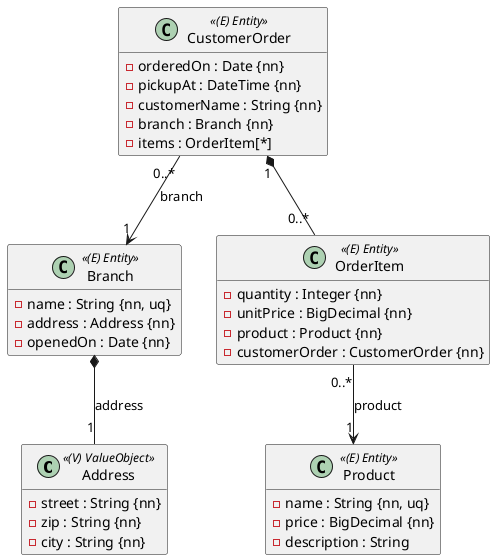
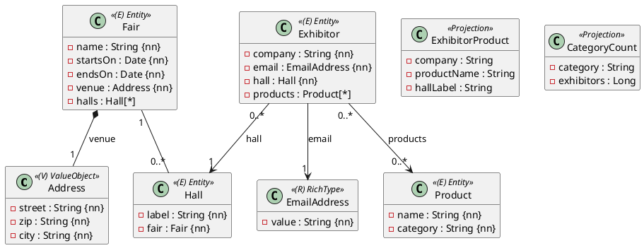

Die vierte volle Probeprüfung: **vier Aufgaben, 300 Minuten, je 17 Punkte** – **beide
OR-Mapping-Aufgaben sind zu lösen**. Zeitplan und Vorgehen:
[So läuft eine Probeprüfung](/pruefungen/ablauf).

| Aufgabe | Thema | Subprojekt | Punkte | Zeit |
|---|---|---|---|---|
| A1 | OR-Mapping: Bäckereikette | `Aufgabe1_ORMapping` (`ormapping1`) | 17 | 70 min |
| A2 | OR-Mapping: Messe (Besonderheit: m:n und Projektionen) | `Aufgabe2_ORMapping` (`ormapping2`) | 17 | 80 min |
| B | Business-Service: Bonusprogramm | `Aufgabe3_BusinessService` | 17 | 75 min |
| C | REST-API: Sensorwerte | `Aufgabe4_RestfulApi` | 17 | 75 min |

## Aufgabe A1 – Bäckereikette (17 Punkte)

Eine Bäckereikette nimmt **Vorbestellungen** für die Abholung in ihren **Filialen** an. Eine
Bestellung besteht aus **Positionen** – je ein **Produkt** mit Anzahl und Preis. Positionen gibt
es nur als Teil ihrer Bestellung.



### Regeln

- **Längen:** `name` der Filiale und des Produkts höchstens 60 Zeichen (beide eindeutig),
  `customerName` 80, `description` 200 (optional); die Adresse wird eingebettet gespeichert
  (`street` 60, `zip` 5, `city` 40, alle Pflicht).
- `price` und `unitPrice` haben Precision 6, Scale 2. `quantity` ist mindestens 1.
- Eine neue Position übernimmt den **aktuellen Preis** des Produkts als `unitPrice` – ändert sich
  der Produktpreis später, bleibt die Bestellung gleich.
- **Komposition:** Bestellung ↔ Positionen ist bidirektional mit `addItem` / `removeItem` und
  unveränderlichem `getItems()`, gemappt mit `cascade = ALL` und **`orphanRemoval = true`**: Eine
  entfernte Position wird gelöscht, eine gelöschte Bestellung löscht ihre Positionen. Produkte
  und Filialen bleiben dabei erhalten.
- `CustomerOrder.total()` liefert die Summe aus Anzahl × Einzelpreis aller Positionen (nicht
  gespeichert).
- **Fremdschlüssel:** `fk_customer_order_branch`, `fk_order_item_order` (Spalte
  `customer_order_id`) und `fk_order_item_product`.

:::achtung `order`
`order` ist in SQL und JPQL ein Schlüsselwort. Deshalb heißen die Klasse `CustomerOrder` und das
Feld in der Position `customerOrder`.
:::

### Implementierung

Entities in `ormapping1.model`, Repositories `BranchRepository`, `ProductRepository`,
`CustomerOrderRepository` und `OrderItemRepository` in `ormapping1.persistence`; jedes Entity erbt
von `AbstractPersistable<Long>`, mit `protected` No-Args-Konstruktor, öffentlichem Konstruktor
ohne `id` und Gettern. Gefordert ist diese abgeleitete Query:

```java
// CustomerOrderRepository – Abholungen einer Filiale im Zeitraum, früheste zuerst
List<CustomerOrder> findByBranchAndPickupAtBetweenOrderByPickupAtAsc(Branch branch, LocalDateTime from, LocalDateTime to);
```

### Tests

Schreibe `@DataJpaTest`s, die eine Bestellung mit Positionen über die Kaskade speichern und nach
`flush()` und `clear()` vollständig wieder lesen (inklusive `total()`). Prüfe vor allem die
Komposition: **Eine entfernte Position ist nach dem Flush aus der Datenbank verschwunden**, eine
gelöschte Bestellung nimmt ihre Positionen mit, Produkte bleiben. Dazu die Regeln für Anzahl und
eindeutige Produktnamen und die Query.

## Aufgabe A2 – Messe (17 Punkte)

Eine **Messe** hat mehrere **Hallen**, in jeder Halle stellen **Aussteller** aus. Jeder Aussteller
zeigt mehrere **Produkte**, und dasselbe Produkt kann bei mehreren Ausstellern stehen – eine
**m:n-Beziehung**. Die Besonderheit dieser Aufgabe: die Join-Tabelle und Auswertungen als
**Projektionen**.



### Regeln

- **Längen:** `name` der Messe und des Produkts höchstens 80 Zeichen, `label` 20, `company` 80,
  `email` 120, `category` 40.
- Der `label` einer Halle ist **innerhalb ihrer Messe** eindeutig (Constraint
  `uk_hall_fair_label` über `fair_id` und `label`) – eine andere Messe darf auch eine Halle „A“
  haben.
- Messe ↔ Hallen ist bidirektional mit `Fair.addHall`; gespeichert wird über die Messe
  (`cascade = PERSIST`), Fremdschlüssel `fk_hall_fair`. Aussteller → Halle: `fk_exhibitor_hall`.
- **m:n Aussteller → Produkte:** Nur der Aussteller kennt seine Produkte. Join-Tabelle
  **`exhibitor_products`** mit den Spalten `exhibitor_id` und `product_id` und den Fremdschlüsseln
  `fk_exhibitor_products_exhibitor` und `fk_exhibitor_products_product`. `addProduct` fügt ein
  Produkt nur einmal hinzu, `removeProduct` entfernt nur die Verbindung (das Produkt bleibt),
  `getProducts()` ist unveränderlich. Produkte sind vorher gespeichert.
- **Projektionen** sind Records in `ormapping2.model`: `ExhibitorProduct(String company, String
  productName, String hallLabel)` und `CategoryCount(String category, Long exhibitors)`.

### Implementierung

Entities in `ormapping2.model`, Repositories `FairRepository`, `ProductRepository` und
`ExhibitorRepository` in `ormapping2.persistence`. Gefordert sind:

```java
// ExhibitorRepository
List<Exhibitor> findByHallFairOrderByCompanyAsc(Fair fair);   // Pfad hall.fair

// Messekatalog: jede Kombination Aussteller–Produkt, sortiert nach Firma und Produkt
List<ExhibitorProduct> catalogue(Fair fair);

// In wie vielen Hallen wird das Produkt gezeigt?
long hallsShowing(Product product);

// Pro Kategorie: Anzahl verschiedener Aussteller auf der Messe, sortiert nach Kategorie
List<CategoryCount> exhibitorsPerCategory(Fair fair);
```

Die letzten drei sind `@Query`-Methoden in JPQL – mit `select new …` für die Projektionen und
`count(distinct …)` für die Zählungen.

### Tests

Prüfe mit `@DataJpaTest`, dass ein Aussteller mit Produkten nach `flush()` und `clear()`
vollständig zurückkommt und dass die Join-Tabelle die richtige Anzahl Zeilen hat – auch nach dem
Entfernen eines Produkts (das Produkt selbst bleibt). Teste die Eindeutigkeit des Hallen-Labels
(gleiche Messe: abgelehnt, andere Messe: erlaubt) und alle vier Abfragen mit Daten, bei denen
`distinct` einen Unterschied macht.

:::achtung `save` nach dem ersten Speichern
`repository.save(entity)` ruft für ein schon gespeichertes Entity `merge` auf, nicht `persist`.
Mit nur `cascade = PERSIST` kommt eine danach hinzugefügte Halle dabei nicht richtig mit. Füge die
Hallen vor dem ersten Speichern hinzu oder speichere eine neue Halle selbst.
:::

## Aufgabe B – Bonusprogramm (17 Punkte)

Die Angabe ist **Aufgabe B aus
[Probeprüfung 8 – Bonusprogramm und Feriencamp-Anmeldungen](/pruefungen/uebungen/bonus-und-anmeldungen)**:
`BonusCalculator` und `TierService` als zwei zusammenarbeitende Klassen, der Rechner in den Tests
gemockt. Bearbeite sie hier im Subprojekt `Aufgabe3_BusinessService`; die Packages bleiben gleich.

## Aufgabe C – Sensorwerte (17 Punkte)

Die Angabe ist **Aufgabe C aus
[Probeprüfung 7 – Energie-Abrechnung und Sensorwerte](/pruefungen/uebungen/energie-und-sensorwerte)**:
optionaler Zeitraum mit höchstens 31 Tagen, `count` zwischen 1 und 100, Tagesstatistik mit `204`.
Bearbeite sie hier im Subprojekt `Aufgabe4_RestfulApi`.

:::merke
Hast du B oder C schon in der mittleren Probeprüfung gelöst, löse sie trotzdem **neu und in der
Zeit** – genau das übt die volle Prüfung: vier Aufgaben in 300 Minuten.
:::

## Abgabe und Feedback

Diese Prüfung wird von der Lehrkraft bewertet: Feedback kommt direkt ins Repository. Bei jedem Push
läuft `./gradlew test` für alle vier Subprojekte – deine eigenen Tests müssen grün sein. Schätze
dich nach der Abgabe selbst ein (unten).
