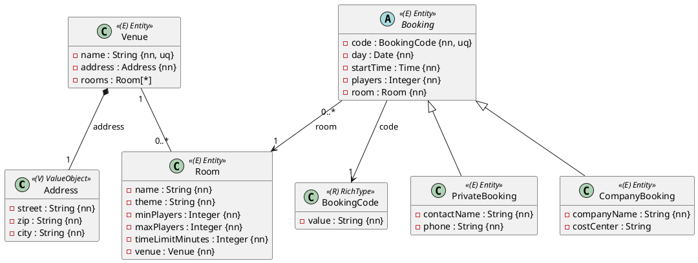

Eine Probeprüfung für die **Lernwerkstatt vor Ort**: **150 Minuten** (drei Schulstunden), zwei
Aufgaben zu je 17 Punkten in **einem** Szenario – eine OR-Mapping-Aufgabe wie Aufgabe 1 und eine
REST-API wie Aufgabe 3 der Matura. Du brauchst das JPA-Modul (Einheiten 1–10, 14, 16 und 17) und
das REST-Modul (Einheiten 1–12). Der Ablauf steht in
[So läuft eine Probeprüfung](/pruefungen/ablauf).

| Aufgabe | Thema | Subprojekt | Punkte | Zeit |
|---|---|---|---|---|
| A | OR-Mapping: Standorte, Räume, Buchungen | `Aufgabe1_ORMapping` | 17 | 75 min |
| C | REST-API: Räume und ihre Buchungen | `Aufgabe3_RestfulApi` | 17 | 75 min |

**Das Szenario:** *Locked In* betreibt Escape Rooms an mehreren **Standorten**. Jeder Standort hat
mehrere **Räume** mit einem Thema, einer Spielerzahl von–bis und einem Zeitlimit. Gruppen
**buchen** einen Raum für einen Tag und eine Startzeit – entweder **privat** (mit
Ansprechperson und Telefonnummer) oder als **Firmen-Event** (mit Firmenname und optionaler
Kostenstelle).

:::achtung Die Aufgaben sind unabhängig
Aufgabe C verwendet **nicht** die Entities aus Aufgabe A – die REST-API arbeitet mit einem
Service-Stub. Fang ruhig mit der Aufgabe an, die dir besser liegt, aber teile dir die Zeit ein:
Nach 75 Minuten wechselst du.
:::

## Aufgabe A – Escape Rooms in die Datenbank (17 Punkte)



### Regeln

- **Längen:** `name` (Standort und Raum) höchstens 60 Zeichen, `theme` 40, `contactName` und
  `companyName` 80, `phone` und `costCenter` 20. Die Adresse wird **eingebettet** gespeichert
  (`street` höchstens 60, `zip` 5, `city` 40 Zeichen, alle Pflicht).
- **Zahlen:** `minPlayers` ist mindestens 1, `maxPlayers` höchstens 10, `timeLimitMinutes` liegt
  zwischen 30 und 120, `players` ist größer als 0.
- **Rich Type:** `BookingCode` ist ein **Record** mit der Komponente `value`: drei Großbuchstaben,
  Bindestrich, fünf Ziffern (`WIE-00042`). Ungültige Werte lehnt der Konstruktor ab
  (`IllegalArgumentException`). Gespeichert wird er über einen **null-sicheren
  `AttributeConverter`** mit `autoApply = true` in einer Spalte `code` der Länge 9.
- **Vererbung:** `Booking` ist abstrakt und mit **`SINGLE_TABLE`** abgebildet. Die
  Diskriminator-Spalte heißt `booking_type` und enthält `PRIVATE` oder `COMPANY`; es gibt nur die
  Tabelle `booking`. `contactName`, `phone` und `companyName` sind Pflicht – aber nur für ihre
  Unterklasse. `costCenter` darf fehlen.
- **Spaltennamen** entsprechen den Attributnamen (`start_time`, `time_limit_minutes`, …). Lässt
  die Datenbank einen Namen nicht zu, heißt die Spalte `booking_<attribut>`.
- **Benannte Constraints:** `uk_booking_code` (Buchungscode eindeutig) und `uk_room_venue_name` –
  ein Raumname ist **pro Standort** eindeutig, zwei Standorte dürfen aber gleich benannte Räume
  haben. Fremdschlüssel `fk_room_venue` und `fk_booking_room` in den Spalten `venue_id` und
  `room_id`.
- **Standort ↔ Räume** ist **bidirektional**: `Venue.addRoom` / `removeRoom` setzen beide Seiten,
  `getRooms()` liefert eine unveränderliche Liste. Gespeichert wird über den Standort
  (`cascade = PERSIST`). Buchungen werden über ihr eigenes Repository gespeichert.

### Implementierung

Entities im Package `ormapping.model`, Repositories in `ormapping.persistence` (`VenueRepository`,
`RoomRepository`, `BookingRepository`, alle `JpaRepository<…, Long>`). Jedes Entity erbt von
`AbstractPersistable<Long>` und hat einen `protected` No-Args-Konstruktor, einen öffentlichen
Konstruktor ohne `id` (bei `Room` auch ohne `venue`) und Getter; `Booking` hat einen `protected`
Konstruktor mit den gemeinsamen Daten. Gefordert sind diese Abfragen:

```java
// BookingRepository – liefert PrivateBooking und CompanyBooking
Optional<Booking> findByCode(BookingCode code);
List<Booking> findByRoomAndDayOrderByStartTimeAsc(Room room, LocalDate day);

// Anzahl der Firmen-Events zwischen from und to, beide Tage eingeschlossen
long countCompanyBookings(LocalDate from, LocalDate to);   // @Query mit JPQL

// RoomRepository – die Räume des Standorts, in denen eine Gruppe dieser Größe spielen darf,
// sortiert nach Name
List<Room> findSuitable(Venue venue, int players);           // @Query mit JPQL
```

### Tests

Schreibe `@DataJpaTest`s, die

- einen Standort mit zwei Räumen über die Kaskade speichern und nach `flush()` und `clear()`
  vollständig wieder lesen,
- eine private und eine Firmenbuchung speichern und prüfen, dass sie **als ihre Unterklasse**
  zurückkommen – mit allen Feldern, auch `day` und `startTime`,
- die Eindeutigkeit von Standortname, Buchungscode und Raumname pro Standort prüfen,
- eine `PrivateBooking` ohne `contactName` und eine Buchung ohne Raum ablehnen,
- alle vier Abfragen prüfen – `findSuitable` genau an `minPlayers` und `maxPlayers` und knapp
  daneben, `countCompanyBookings` an beiden Datumsgrenzen.

:::merke
Startet der Test-Kontext nicht, lies die **erste** Fehlermeldung im Log genau: Sie zeigt das
`create table`, an dem H2 scheitert.
:::

## Aufgabe C – Räume und Buchungen als REST-API (17 Punkte)

*Locked In* stellt seine Räume und deren Buchungen über eine REST-API bereit. Alle Endpunkte
liegen unter **`/api/rooms`**, das Datenformat ist JSON. Controller und Fehlerbehandlung gehören
ins Package `restfulapi.presentation`, der Service und die Datenklassen nach `restfulapi.service`.

### Schnittstellenobjekte

```json
// roomView
{
  "id": 7,
  "name": "Grab des Pharao",
  "theme": "Ägypten",
  "venue": "Wien Mitte",
  "min-players": 2,
  "max-players": 6,
  "time-limit": 60
}
```

```json
// room – Body zum Anlegen und zum Ersetzen
{
  "name": "Grab des Pharao",
  "theme": "Ägypten",
  "venue": "Wien Mitte",
  "min-players": 2,
  "max-players": 6,
  "time-limit": 60
}
```

```json
// bookingView
{
  "code": "WIE-00042",
  "day": "2026-12-05",
  "start": "18:30:00",
  "players": 4,
  "type": "PRIVATE",
  "booked-by": "Lena Berger"
}
```

Regeln für `room`: `name` ist nicht leer und höchstens 60 Zeichen lang, `theme` nicht leer und
höchstens 40, `venue` nicht leer und höchstens 60. `min-players` und `max-players` liegen
zwischen 1 und 10, `time-limit` zwischen 30 und 120 Minuten. Alle Felder sind Pflicht.

`type` ist `PRIVATE` oder `COMPANY`; `booked-by` ist die Ansprechperson einer privaten Buchung
bzw. der Firmenname eines Firmen-Events. Das eingehende Objekt ist ein Command (`RoomCmd`), die
ausgehenden heißen `RoomView` und `BookingView`. Die `id` eines Raums vergibt der Service.

### Endpunkte

- **Alle Räume lesen**, optional nur die Räume, in denen eine Gruppe einer bestimmten Größe
  spielen darf (`?players=4`, erlaubt sind 1 bis 10)
- **Einen Raum lesen**
- **Einen Raum anlegen** – `201` mit `Location` auf den neuen Raum
- **Einen Raum ersetzen** – alle Felder werden neu gesetzt
- **Die Buchungen eines Raums lesen**, sortiert nach Tag und Startzeit (sortiert schon der
  Service), optional nur die eines Tages (`?day=2026-12-05`)

Halte dich an die REST-Prinzipien: Pfade für Ressourcen und Unterressourcen, passende
HTTP-Methoden, Statuscodes wie `200`, `201` mit `Location`, `400`, `404` und `409`.

### Der Service

Lege einen `RoomService` mit `@Service` als **Stub** an. Er meldet Fehler mit eigenen
Exceptions:

- Raum nicht gefunden („room not found: 99“) – beim Ersetzen und bei den Buchungen
- Raum existiert schon: Der Standort hat bereits einen Raum mit diesem Namen („room Grab des
  Pharao already exists in Wien Mitte“) – beim Anlegen und beim Ersetzen

### Fehler

Jeder Fehler wird als `ProblemDetail` mit einer **eindeutigen Referenz** (Feld `reference`)
beantwortet, und die Exception wird mit dieser Referenz geloggt. Bei Validierungsfehlern nennt
`detail` jedes fehlerhafte Feld. Auch unerwartete Fehler werden so beantwortet – mit `500`, ohne
Springs eigene Fehler (`400`, `404`, `405`, `415`) zu verfälschen.

### Tests

Stelle mit `@WebMvcTest` und einem `@MockitoBean` des Service sicher, dass alle Endpunkte
funktionieren – mit Good Cases, Edge Cases (leere Listen, `players` und Zahlen im Body genau an den
Grenzen, Raum ohne Buchungen) und Exception Cases (ungültiger Body, `?players=0`, ungültiges Datum
im Filter, `404`, `409`). Bei ungültigen Eingaben darf der Service gar nicht aufgerufen werden.

:::pruefung
Bei jedem Push läuft `./gradlew test` für beide Subprojekte. Ob deine Tests grün sind, siehst du im
Repository; die Beurteilung macht deine Lehrkraft nach den Kriterien unten.
:::
