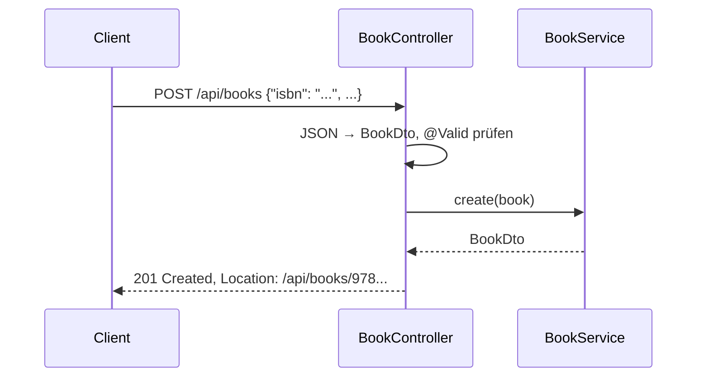

In Aufgabe 3 baust du eine **RESTful API**: Endpunkte, die JSON lesen und schreiben, mit den richtigen HTTP-Methoden und Statuscodes – und Tests, die das beweisen. Das Service dahinter ist nur ein Stub; im Test ersetzt du es durch einen Mock.

## Ressourcen und Pfade

Eine REST-API spricht über **Ressourcen**, nicht über Aktionen. Der Pfad nennt die Ressource (Mehrzahl), die HTTP-Methode die Aktion:

| Methode | Pfad | Bedeutung | Erfolg |
|---|---|---|---|
| `GET` | `/api/books` | alle Bücher lesen | `200 OK` |
| `GET` | `/api/books/{isbn}` | ein Buch lesen | `200 OK` |
| `POST` | `/api/books` | ein Buch anlegen | `201 Created` + `Location` |
| `PUT` | `/api/books/{isbn}` | ein Buch ersetzen | `200 OK` |
| `PATCH` | `/api/books/{isbn}` | ein Buch teilweise ändern | `200 OK` |
| `DELETE` | `/api/books/{isbn}` | ein Buch löschen | `204 No Content` |
| `GET` | `/api/books/{isbn}/loans` | die Ausleihen eines Buchs | `200 OK` |

Nicht RESTful sind Pfade mit Verben: `/api/getBook?id=…`, `/api/books/delete/{isbn}`.

## Ein Aufruf von Anfang bis Ende

## Statuscodes, die du brauchst

| Code | Wann |
|---|---|
| `200 OK` | gelesen oder geändert, mit Body |
| `201 Created` | neu angelegt, mit `Location`-Header auf die neue Ressource |
| `204 No Content` | gelöscht, ohne Body |
| `400 Bad Request` | ungültige Eingabe (Validierung, kaputtes JSON) |
| `404 Not Found` | die Ressource gibt es nicht |
| `409 Conflict` | widerspricht dem aktuellen Zustand, z. B. „existiert schon“ |
| `500 Internal Server Error` | ein Fehler, den niemand behandelt hat – darf nicht vorkommen |

## Wie beurteilt wird

| Note | Erwartet |
|---|---|
| Genügend | Endpunkte und Datenklassen richtig definiert, Details fehlen, Tests rudimentär |
| Befriedigend | Endpunkte und Datenklassen vollständig, die **Good Cases** sind getestet |
| Gut | auch die **Edge Cases** sind getestet |
| Sehr gut | auch die **Exception Cases** sind getestet |

Erwartet werden außerdem: Pfade nach REST-Prinzipien, richtige Methoden und Statuscodes, behandelte Exceptions, Datenklassen für jedes JSON-Objekt und ein Service-Stub, der im Test durch einen Mock ersetzt wird.

:::merke
- Pfad = Ressource in Mehrzahl, Methode = Aktion.
- `201` mit `Location` beim Anlegen, `204` beim Löschen, `404`/`400`/`409` für Fehler.
- Gute Noten kommen von den Tests: Good → Edge → Exception Cases.
:::
