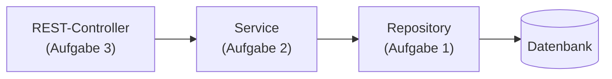

In Aufgabe 2 programmierst du **Geschäftslogik**: Regeln, Berechnungen und Auswertungen über Daten, die du selbst im Test erzeugst. Es gibt keine Datenbank und keine REST-Schnittstelle – nur Java, ein Service und Tests.

## Wo das Service sitzt



In einer echten Anwendung nimmt der Controller eine Anfrage entgegen, das Service wendet die Regeln an, und das Repository liest die Daten. In der Prüfung baust du jede Schicht für sich: In Aufgabe 2 kommen die Daten nicht aus der Datenbank, sondern aus deinen Tests.

## Zwei Formen der Angabe

**1. Die Daten werden übergeben.** Die Angabe zeigt Datenklassen und das Service in Pseudocode:

```text
klasse RevenueAttributionService {
  RevenueAttributionService(Liste<Song> songs)
  Long streamingSecondsForArtist(Liste<StreamingLogEntry> entries, Artist artist)
}
```

Dazu kommen Regeln wie „Streams unter 5 Sekunden sind zu verwerfen“. Du schreibst die Datenklassen, das Service und Tests.

**2. Es gibt eine Datenzugriffsschnittstelle.** „Es ist eine Datenzugriffsschnittstelle anzunehmen … Die Datenzugriffsklassen sollen in den Tests gemockt oder durch Stubs ersetzt werden.“ Das Service bekommt ein Interface, das du nicht implementierst. Im Test ersetzt du es (Einheit 7). Oft verlangt die Angabe ein zusammengefasstes Ergebnis, etwa eine `Map` von Beurteilungen mit sortierten Listen (Einheit 4).

## Wie beurteilt wird

| Note | Erwartet |
|---|---|
| Genügend | Datenklassen und Service sind vorhanden, aber nicht getestet |
| Befriedigend | Einzelne Basis-Geschäftsfälle sind getestet |
| Gut | **Alle** Geschäftsfälle sind getestet und laufen durch |
| Sehr gut | Zusätzlich ist der Code auf mehrere Klassen aufgeteilt |

Die Tests zählen also so viel wie der Code. Ein Service ohne Tests ist höchstens genügend.

## Das Beispiel in diesem Modul

Die Bücherei aus dem JPA-Modul verlangt Mahngebühren:

- Die Leihfrist beträgt 28 Tage.
- Verspätungen bis einschließlich 2 Tage sind kostenlos.
- Danach kostet jeder Tag Verspätung 20 Cent – ab dem ersten Tag nach der Leihfrist.
- Pro Ausleihe höchstens 10 €.
- Kinder zahlen die Hälfte.

Daraus bauen wir in den nächsten Einheiten Datenklassen, ein Service, eine Auswertung und die Tests.

:::merke
- Aufgabe 2 = Datenklassen + Service mit Geschäftsregeln + Tests, ohne Datenbank und ohne REST.
- Daten kommen über den Konstruktor/die Parameter oder über ein Interface, das im Test ersetzt wird.
- „Gut“ heißt: alle Geschäftsfälle getestet. „Sehr gut“: zusätzlich sinnvoll aufgeteilt.
:::
