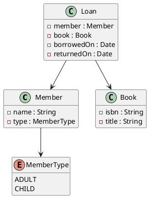

Die Angabe ist kein Java. Sie beschreibt Datenklassen in einem Diagramm und das Service in Pseudocode. Deine erste Aufgabe: beides sauber übersetzen, bevor du eine einzige Regel programmierst.

## Datenklassen als Records



Die Datenklassen haben keine Identität und kein Verhalten: Records passen genau (Modul Stream API, Einheit 9).

```java
package businessservice.model;

public record Member(String name, MemberType type) {

    public Member {
        Objects.requireNonNull(name, "name");
        Objects.requireNonNull(type, "type");
    }
}

public record Book(String isbn, String title) {
}

/** returnedOn ist null, solange das Buch ausgeliehen ist. */
public record Loan(Member member, Book book, LocalDate borrowedOn, LocalDate returnedOn) {
}
```

| Angabe | Java |
|---|---|
| `String`, `Integer`, `Long` | `String`, `int`/`Integer`, `long`/`Long` |
| `Date` | `LocalDate` |
| `DateTime` | `LocalDateTime` |
| `Time` | `LocalTime` |
| `Liste<X>`, `X[*]` | `List<X>` |
| `«enum»` | `enum` |

Ein Attribut, das fehlen darf (hier `returnedOn`), dokumentierst du – oder bietest zusätzlich eine Methode mit `Optional` an:

```java
public Optional<LocalDate> returned() {
    return Optional.ofNullable(returnedOn);
}
```

## Das Service aus dem Pseudocode

```text
klasse LateFeeService {
  ## Alle Ausleihen werden zu Beginn übergeben
  LateFeeService(Liste<Loan> loans)

  ## Summe der Gebühren eines Mitglieds in Cent
  Integer feeFor(Member member, Date today)
}
```

```java
package businessservice.service;

public class LateFeeService {

    private final List<Loan> loans;

    public LateFeeService(List<Loan> loans) {
        this.loans = List.copyOf(Objects.requireNonNull(loans, "loans"));
    }

    public int feeFor(Member member, LocalDate today) {
        return 0; // kommt in Einheit 3
    }
}
```

- Der Konstruktor speichert, was die Angabe „zu Beginn übergibt“. `List.copyOf` schützt das Service davor, dass jemand die Liste von außen ändert.
- Die Methodennamen übernimmst du aus der Angabe. Typen übersetzt du nach der Tabelle oben.
- Das Seed-Projekt hat dafür das Subprojekt `Aufgabe2_BusinessService` mit dem Package `businessservice.service`.

:::pruefung
„Dieser Pseudocode soll als Inspiration dienen – passen Sie diese Vorgabe entsprechend Ihrer Programmiersprache an.“ Ein `Long` darf ein `long` werden, eine `Liste` eine `List`. Bleib aber bei den Namen der Angabe, damit die Beurteilung deinen Code wiederfindet.
:::

## Erst kompilieren, dann Regeln

Lege Datenklassen und Service mit leeren Methoden an und schreib den ersten Test, der nur ein Service erzeugt und eine Methode aufruft. Kompiliert das, hast du das Gerüst – und jeder weitere Schritt ist eine Regel mit ihrem Test.

:::merke
- Datenklassen → Records, `Date` → `LocalDate`, `Liste` → `List`.
- Service-Konstruktor speichert die übergebenen Daten (`List.copyOf`).
- Namen aus der Angabe übernehmen, Typen an Java anpassen.
:::
