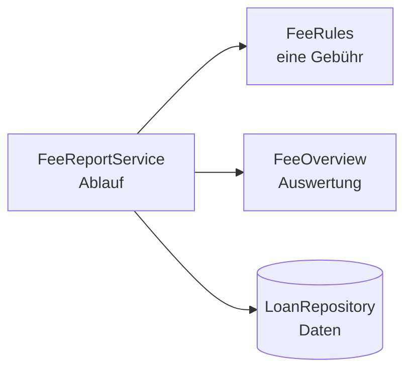

„Sehr gut“ verlangt zusätzlich, dass „der Code auf mehrere Klassen aufgeteilt und damit wartbarer gestaltet ist“. Ein Service mit 150 Zeilen, in dem Regeln, Berechnung und Auswertung durcheinanderstehen, erfüllt das nicht.

## Wer macht was?



| Klasse | Verantwortung |
|---|---|
| `FeeRules` | die Regeln: Verspätung, Kulanz, Deckel, Kinder |
| `FeeOverview` | Einteilung in Stufen, Sortierung |
| `FeeReportService` | holt die Daten, ruft Regeln und Auswertung auf |

Jede Klasse hat **einen Grund, sich zu ändern**: Ändert die Bücherei die Gebühr pro Tag, ändert sich nur `FeeRules`.

## Die Regeln als eigene Klasse

```java
public class FeeRules {

    static final int LOAN_DAYS = 28;
    static final int GRACE_DAYS = 2;
    static final int CENTS_PER_DAY = 20;
    static final int MAX_CENTS_PER_LOAN = 1000;

    public int fee(Loan loan, LocalDate today) {
        long late = daysLate(loan, today);
        if (late <= GRACE_DAYS) {
            return 0;
        }
        int cents = (int) Math.min(late * CENTS_PER_DAY, MAX_CENTS_PER_LOAN);
        return loan.member().type() == MemberType.CHILD ? cents / 2 : cents;
    }

    long daysLate(Loan loan, LocalDate today) { ... }
}
```

```java
public class FeeReportService {

    private final LoanRepository loanRepository;
    private final FeeRules rules;

    public FeeReportService(LoanRepository loanRepository, FeeRules rules) {
        this.loanRepository = loanRepository;
        this.rules = rules;
    }
}
```

Das Service bekommt die Regeln im Konstruktor – genau wie das Repository. Im Test übergibst du `new FeeRules()`.

## Tests passend aufteilen

- `FeeRulesTest`: alle Randwerte, ohne Repository, ohne Mock.
- `FeeOverviewTest`: Stufen und Sortierung mit fertigen `MemberFee`s.
- `FeeReportServiceTest`: das Zusammenspiel, mit Stub oder Mock.

Jede Testklasse wird kürzer, und ein roter Test zeigt sofort, welcher Teil kaputt ist.

## Wie weit aufteilen?

Für die Prüfung reichen zwei bis vier Klassen neben den Datenklassen. Teile nach **Aufgaben** auf (Regeln, Berechnung, Auswertung), nicht nach Zeilenzahl. Eine Klasse pro Methode macht den Code nicht wartbarer.

:::merke
- Regeln, Auswertung und Ablauf in eigene Klassen.
- Abhängigkeiten über den Konstruktor übergeben.
- Pro Klasse eine Testklasse.
:::
