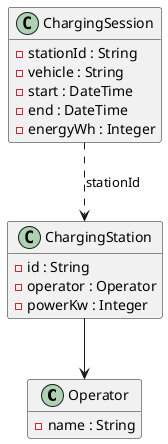

Ein Verbund von Ladestationen für E-Autos rechnet seine Ladevorgänge ab. Du schreibst den Service, der für einen Betreiber den Umsatz und für eine Station die geladene Energie berechnet.

Du brauchst dafür die Einheiten 1–6 im Modul Service-Schicht. Die Aufgabe hat die Größe von Aufgabe 2 der Matura: ohne Datenbank, ohne REST, nur Java und Tests.

## Das Modell



## Abrechnungsregeln

- Ladevorgänge, die **kürzer als 2 Minuten** dauern, werden verworfen: Sie kosten nichts und zählen nicht zur Energie.
- Stationen bis einschließlich **22 kW** laden mit Wechselstrom (AC) und kosten **39 Cent pro kWh**, stärkere Stationen (DC) **59 Cent pro kWh**. Der Energiepreis wird auf ganze Cent gerundet (ab 0,5 aufrunden).
- Wer länger als **240 Minuten** an der Station steht, zahlt eine Blockiergebühr: **10 Cent pro angefangener Minute** danach, höchstens **12 €** pro Ladevorgang.
- Der Preis eines Ladevorgangs ist Energiepreis plus Blockiergebühr. Alle Beträge in Cent.

## Der Service (Pseudocode)

```text
klasse ChargingBillingService {
  ## Die Stationen werden zu Beginn übergeben
  ChargingBillingService(Liste<ChargingStation> stations)

  ## Summe der Preise aller Ladevorgänge an Stationen des Betreibers, in Cent
  Long revenueCentsForOperator(Liste<ChargingSession> sessions, Operator operator)

  ## Summe der geladenen Energie an einer Station in Wh (verworfene Vorgänge zählen nicht)
  Long energyWhForStation(Liste<ChargingSession> sessions, String stationId)
}
```

Gibt es eine Station mit der angegebenen Id nicht – als Parameter oder in einem Ladevorgang –, wirft der Service eine `UnknownStationException`. Ungültige Daten (Ende vor Beginn, negative Energie, Leistung ≤ 0) werden schon beim Erzeugen der Datenklassen mit einer `IllegalArgumentException` abgelehnt.

Lege die Datenklassen im Package `businessservice.model` und den Service in `businessservice.service` an.

## Tests

Stelle durch Tests sicher, dass jede Regel richtig umgesetzt ist – auch an ihren Grenzen (genau 2 Minuten, genau 22 kW, genau 240 Minuten, genau 12 €) – und dass der Service nur die Ladevorgänge des richtigen Betreibers bzw. der richtigen Station berücksichtigt.

:::pruefung
Bei jedem Push läuft `./gradlew test`. Ob deine Tests grün sind, siehst du im Repository; die Beurteilung macht deine Lehrkraft nach den Kriterien unten.
:::
