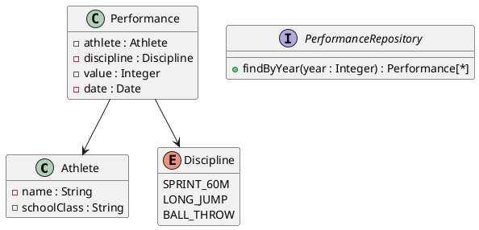

Beim Schulsportfest kann jede Schülerin und jeder Schüler das Sportabzeichen erwerben. Du schreibst das Service, das für ein Jahr alle Ergebnisse auswertet.

Du brauchst dafür die Einheiten 1–8 im Modul Service-Schicht, vor allem Einheit 4 (Ergebnisse zusammenfassen) und Einheit 7 (Datenzugriff).

## Das Modell



`value` ist beim Sprint die Zeit in Hundertstelsekunden (**weniger ist besser**), beim Weitsprung und Ballwurf die Weite in Zentimetern (**mehr ist besser**).

Es ist eine Datenzugriffsschnittstelle `PerformanceRepository` anzunehmen, die alle Ergebnisse eines Jahres liefert. Sie wird nicht implementiert; in den Tests ersetzt du sie durch einen Mock oder Stub.

## Regeln

| Disziplin | Bronze | Silber | Gold |
|---|---|---|---|
| `SPRINT_60M` | ≤ 10,50 s | ≤ 9,80 s | ≤ 9,20 s |
| `LONG_JUMP` | ≥ 3,30 m | ≥ 3,80 m | ≥ 4,30 m |
| `BALL_THROW` | ≥ 28 m | ≥ 34 m | ≥ 40 m |

- In jeder Disziplin zählt der **beste** Versuch des Jahres.
- Bronze bringt 1 Punkt, Silber 2, Gold 3; wer die Bronze-Grenze nicht schafft, bekommt 0.
- Ein Abzeichen bekommt nur, wer in **allen drei** Disziplinen mindestens Bronze erreicht. Dann gilt: ab 8 Punkten **Gold**, ab 5 Punkten **Silber**, sonst **Bronze**.
- Alle anderen bekommen **kein** Abzeichen.
- Ergebnisse aus anderen Jahren werden ignoriert, auch wenn das Repository sie liefert.

## Das Service

```text
klasse BadgeService {
  BadgeService(PerformanceRepository repository)

  ## Alle Teilnehmenden des Jahres, eingeteilt nach Abzeichen
  Map<Badge, Liste<BadgeResult>> badges(Integer year)
}
```

- `Badge` ist ein Enum mit `GOLD`, `SILVER`, `BRONZE` und `NONE`. Die Map enthält **immer alle vier** Schlüssel, auch wenn eine Liste leer ist.
- Ein `BadgeResult` enthält Name, Klasse und die Summe der Punkte.
- Jede Liste ist **absteigend nach Punkten** sortiert, bei Gleichstand alphabetisch nach Namen.

## Tests

Stelle durch Tests sicher, dass die Punkte an allen Grenzen stimmen, dass der beste Versuch zählt, dass die Abzeichen richtig vergeben werden und dass die Listen richtig sortiert sind. Übergib die Testdaten absichtlich unsortiert.

:::pruefung
Bei jedem Push läuft `./gradlew test`. Ob deine Tests grün sind, siehst du im Repository; die Beurteilung macht deine Lehrkraft nach den Kriterien unten.
:::
