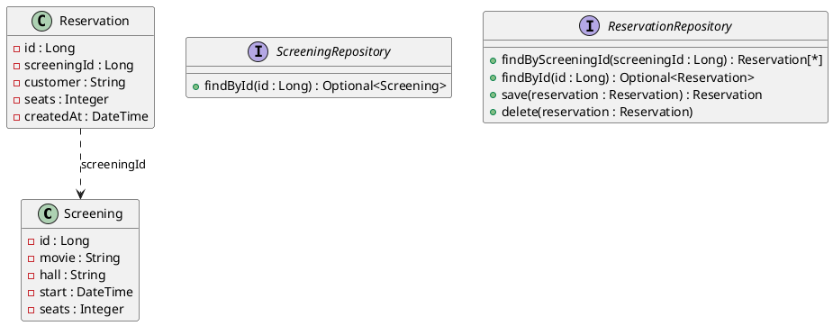

Ein Kino nimmt Reservierungen online an. Du schreibst das Service dahinter, so wie es später ein REST-Controller (Aufgabe 3) verwendet.

Du brauchst dafür das ganze Modul Service-Schicht, vor allem die Einheiten 9 und 10.

## Das Modell



`save` liefert die gespeicherte Reservierung mit vergebener Id zurück; eine neue Reservierung hat noch keine Id (`null`).

## Das Service

```text
@Service klasse ReservationService {
  ReservationService(ScreeningRepository screenings, ReservationRepository reservations)

  AvailabilityDto availability(Long screeningId)
  ReservationDto reserve(Long screeningId, String customer, Integer seats, DateTime now)
  void cancel(Long reservationId, DateTime now)
}
```

- `AvailabilityDto`: Id der Vorstellung, Film, Plätze gesamt, reserviert, frei.
- `ReservationDto`: Id der Reservierung, Film, Saal, Beginn, Kunde, Plätze.

`now` wird übergeben, damit die Tests die Zeit festlegen können.

## Regeln

- Eine Reservierung umfasst **1 bis 8** Plätze, und der Kunde darf nicht leer sein (Leerzeichen am Rand werden entfernt) – sonst `IllegalArgumentException`.
- Reservieren ist bis **31 Minuten** vor Beginn möglich; ab 30 Minuten vor Beginn wirft das Service eine `ReservationClosedException`.
- Es dürfen nicht mehr Plätze reserviert werden, als frei sind – sonst `NotEnoughSeatsException` mit einer Nachricht wie `requested 4 seats, only 3 free`.
- Stornieren ist bis **mehr als 2 Stunden** vor Beginn möglich, danach `ReservationClosedException`.
- Unbekannte Vorstellungen oder Reservierungen: `ScreeningNotFoundException` bzw. `ReservationNotFoundException`.
- Bei einem Fehler wird nichts gespeichert und nichts gelöscht.

## Spring

`ReservationService` bekommt `@Service`. Damit der Test `contextLoads` des Seed-Projekts weiter läuft, legst du für beide Interfaces eine einfache Implementierung mit `@Repository` an, die die Daten in einer `Map` hält (`InMemoryScreeningRepository`, `InMemoryReservationRepository`).

## Tests

Teste das Service mit `@ExtendWith(MockitoExtension.class)` und Mocks für beide Repositories: gute Fälle, Randfälle (die letzten freien Plätze, die Zeitgrenzen) und jeden Fehlerfall. Prüfe mit `verify`, was gespeichert oder gelöscht wird.

:::pruefung
Bei jedem Push läuft `./gradlew test`. Ob deine Tests grün sind, siehst du im Repository; die Beurteilung macht deine Lehrkraft nach den Kriterien unten.
:::
