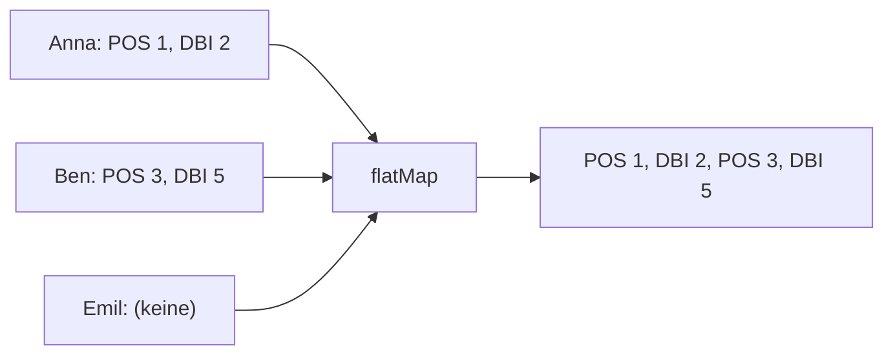

Jeder Schüler hat eine Liste von Noten. Willst du **alle** Noten aller Schüler, bekommst du mit `map` eine Liste von Listen:

```java
List<List<Grade>> nested = students.stream()
        .map(Student::grades)
        .toList();
// [[POS 1, DBI 2], [POS 3, DBI 5], [POS 2, DBI 2], [POS 4], []]
```

Damit kannst du schlecht weiterarbeiten. `flatMap` **macht die Listen flach**: Jedes Element wird zu einem Stream, und alle diese Streams werden zu einem zusammengehängt.

```java
List<Grade> allGrades = students.stream()
        .flatMap(s -> s.grades().stream())
        .toList();
// [POS 1, DBI 2, POS 3, DBI 5, POS 2, DBI 2, POS 4]
```



Der Unterschied in einem Satz: `map` macht aus **einem** Element **ein** neues, `flatMap` macht aus **einem** Element **beliebig viele** (auch keines – Emil trägt nichts bei).

Wichtig: Das Lambda von `flatMap` muss einen **Stream** liefern, deshalb `s.grades().stream()`.

## Weiterarbeiten nach `flatMap`

Danach ist es ein ganz normaler Stream von Noten:

```java
// In welchen Fächern gibt es Noten?
students.stream()
        .flatMap(s -> s.grades().stream())
        .map(Grade::subject)
        .distinct()
        .sorted()
        .toList();
// [DBI, POS]
```

## Den Schüler nicht verlieren

Nach `flatMap(s -> s.grades().stream())` weißt du nicht mehr, zu welchem Schüler eine Note gehört. Brauchst du beides, kombiniere sie **innerhalb** des Lambdas:

```java
students.stream()
        .flatMap(s -> s.grades().stream()
                .map(g -> s.name() + ": " + g.subject() + " " + g.value()))
        .toList();
// [Anna: POS 1, Anna: DBI 2, Ben: POS 3, ...]
```

## Ohne flatMap geht es auch

Für die Frage „Wer hat eine negative Note?“ brauchst du kein `flatMap` – ein Stream **im** Filter reicht:

```java
students.stream()
        .filter(s -> s.grades().stream().anyMatch(g -> !g.isPositive()))
        .map(Student::name)
        .toList();
// [Ben]
```

:::merke
- `flatMap(x -> x.liste().stream())` macht aus vielen Listen einen Stream.
- `map`: 1 → 1, `flatMap`: 1 → 0..n.
- Brauchst du das äußere Objekt noch, kombiniere im Lambda von `flatMap`.
:::
