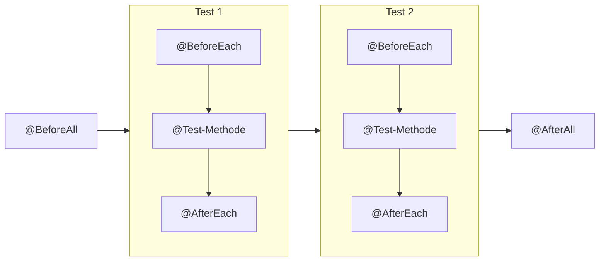

Viele Tests einer Klasse brauchen dieselbe Ausgangslage: einen leeren Warenkorb, ein paar Testdaten, ein frisches Service-Objekt. Statt das in jedem Test zu wiederholen, legst du es in eine **Lifecycle-Methode**.

## `@BeforeEach` und `@AfterEach`

Eine Methode mit `@BeforeEach` läuft **vor jedem** Test, eine mit `@AfterEach` **nach jedem** Test.

```java
import org.junit.jupiter.api.BeforeEach;
import org.junit.jupiter.api.Test;

import static org.assertj.core.api.Assertions.assertThat;

class CartTest {

    private Cart cart;

    @BeforeEach
    void setUp() {
        cart = new Cart();
        cart.add(new Item("Buch", 20.0));
    }

    @Test
    void verify_total_of_one_item() {
        assertThat(cart.total()).isEqualTo(20.0);
    }

    @Test
    void verify_clear_empties_cart() {
        cart.clear();

        assertThat(cart.isEmpty()).isTrue();
    }
}
```

Weil JUnit für **jeden** Test eine neue Instanz von `CartTest` anlegt und `setUp()` davor aufruft, startet jeder Test mit genau einem Buch im Warenkorb – egal, ob ein anderer Test den Warenkorb vorher geleert hat.

## `@BeforeAll` und `@AfterAll`

Diese Methoden laufen **einmal** für die ganze Testklasse: vor dem ersten und nach dem letzten Test. Sie müssen `static` sein, denn zu diesem Zeitpunkt gibt es noch keine Instanz der Testklasse.

```java
@BeforeAll
static void loadPriceList() {
    // teuer, z. B. eine Datei einlesen – nur einmal
}
```

Die Reihenfolge für eine Klasse mit zwei Tests:



:::achtung Gemeinsamer Zustand
Was du in `@BeforeAll` in ein `static`-Feld legst, teilen sich **alle** Tests. Ändert ein Test dieses Objekt, sieht der nächste Test die Änderung. Veränderliche Testdaten gehören deshalb in `@BeforeEach`.
:::

## Wofür brauche ich `@AfterEach`?

In reinen Java-Tests selten: Der Garbage Collector räumt die Objekte ohnehin weg. Sinnvoll ist `@AfterEach`, wenn ein Test etwas **außerhalb** des Objekts verändert, z. B. eine Datei anlegt oder eine statische Einstellung umstellt.

In `@DataJpaTest`-Tests brauchst du es meist auch nicht: Jeder Test läuft dort in einer Transaktion, die am Ende zurückgerollt wird.

:::pruefung
Bei Aufgabe 2 musst du Testdaten selbst erzeugen. Bau sie in einer `@BeforeEach`-Methode oder in Hilfsmethoden auf (siehe Einheit „Testdaten“), dann bleiben die einzelnen Tests kurz und lesbar.
:::

:::merke
- `@BeforeEach` / `@AfterEach`: vor bzw. nach **jedem** Test.
- `@BeforeAll` / `@AfterAll`: **einmal** pro Testklasse, Methode ist `static`.
- Veränderliche Testdaten immer in `@BeforeEach` neu anlegen.
:::
