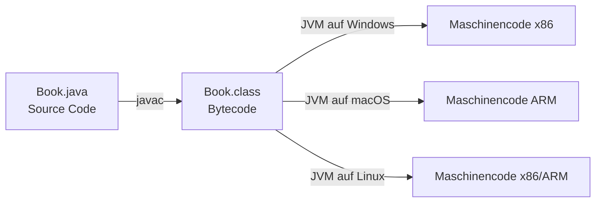

So könnte die Fragestellung lauten:

> Du lieferst dieselbe `.jar`-Datei an drei Kunden aus – einer arbeitet unter Windows, einer unter Linux, einer unter macOS. Was passiert zwischen dem Schreiben des Quellcodes und dem Moment, in dem das Programm beim Kunden läuft, und was muss der Kunde dafür installiert haben? Wie sähe das aus, wenn die Anwendung in TypeScript oder in einer Sprache wie C, Rust oder Go geschrieben wäre?

## Schreibübung

Nimm dir **5 Minuten** und schreib deine Antwort in Stichworten. Erst dann weiterlesen.

## Das Wissen dahinter

1. **Kompilieren:** `javac` (in der Matura: Gradle) übersetzt `.java` in **Bytecode** (`.class`, gepackt als `.jar`). Bytecode ist kein Maschinencode für einen bestimmten Prozessor, sondern Code für eine gedachte Maschine.
2. **Ausführen:** Die **JVM** (Java Virtual Machine) lädt den Bytecode, interpretiert ihn und übersetzt häufig benutzte Teile zur Laufzeit in echten Maschinencode (**JIT-Compiler**, *Just in Time*). Außerdem verwaltet sie den Speicher (**Garbage Collector**).
3. **Plattformunabhängig:** Es gibt eine JVM für jedes Betriebssystem und jeden Prozessor. Dasselbe `.jar` läuft überall, wo eine passende JVM installiert ist: *„Write once, run anywhere.“*
4. **Am Zielsystem nötig:** eine **JRE/JDK** in passender Version (z. B. Java 25). Alternative: das Runtime mitliefern (`jlink`, Docker-Image) oder nativ kompilieren (GraalVM Native Image).
5. **C# / .NET:** genau gleiches Prinzip – C# → **IL-Code** (Intermediate Language) → **CLR** mit JIT.

## Vergleich

| | Java / C# | TypeScript | C, Rust, Go |
|---|---|---|---|
| Übersetzung | in Bytecode/IL | **transpiliert** in JavaScript (`tsc`), Typen fallen weg | direkt in **Maschinencode** für ein Zielsystem |
| Ausführung | JVM/CLR, JIT | JavaScript-Engine (Browser, Node.js – V8 mit JIT) | direkt vom Prozessor |
| Am Zielsystem nötig | Java-Runtime / .NET-Runtime | Browser oder Node.js | nichts (Go: statisch gelinkt; C: evtl. Bibliotheken) |
| Andere Plattform | gleiches `.jar` | gleiches `.js` | **neu kompilieren** pro Betriebssystem und Prozessor (Cross-Compiling) |
| Typprüfung | Compile-Zeit + Laufzeit | nur beim Kompilieren | Compile-Zeit |

## Musterantwort

> Java-Quellcode wird vom Compiler `javac` nicht direkt in Maschinencode übersetzt, sondern in **Bytecode** (`.class`-Dateien, meist in einem `.jar` zusammengefasst). Diesen Bytecode führt die **Java Virtual Machine** aus: Sie interpretiert ihn und übersetzt oft verwendete Teile zur Laufzeit mit dem **JIT-Compiler** in Maschinencode des jeweiligen Prozessors. Außerdem übernimmt sie die Speicherverwaltung (Garbage Collection). Weil es für Windows, Linux und macOS jeweils eine JVM gibt, läuft dasselbe `.jar` auf allen Systemen. Am Zielsystem muss dafür eine **Java-Runtime (JRE/JDK)** in passender Version installiert sein. C# funktioniert genauso: Übersetzung in IL-Code, Ausführung durch die CLR.
>
> **TypeScript** wird mit `tsc` in JavaScript **transpiliert**; die Typen existieren danach nicht mehr. Ausgeführt wird das JavaScript von einer Engine im Browser oder von Node.js – dort muss also ein Browser bzw. Node installiert sein. **C, Rust und Go** werden dagegen direkt in Maschinencode für ein bestimmtes Betriebssystem und eine bestimmte Prozessorarchitektur kompiliert. Das Programm braucht keine Laufzeitumgebung und startet sehr schnell, muss aber für jede Zielplattform **eigens kompiliert** werden.

:::pruefung
Checkliste – hast du …
- **Bytecode** und **JVM** genannt und erklärt?
- **JIT** und **Garbage Collector** erwähnt?
- die **Plattformunabhängigkeit** begründet (eine JVM pro Plattform, gleiches `.jar`)?
- gesagt, was **installiert** sein muss (JRE/JDK)?
- **TypeScript** (transpiliert → JavaScript → Browser/Node) verglichen?
- **C/Rust/Go** (nativer Maschinencode, pro Plattform neu kompilieren, keine Runtime) verglichen?
:::
