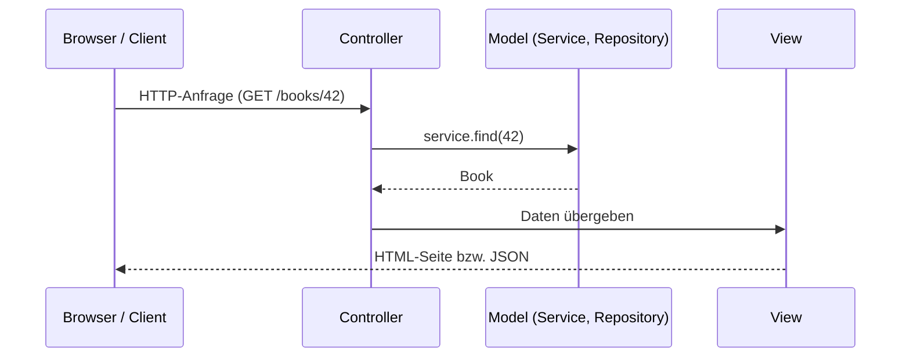

So könnte die Fragestellung lauten:

> Erkläre das Architekturmuster **Model View Controller**: Welche Teile gibt es, welche Aufgabe hat jeder Teil, und wie arbeiten sie bei einer Anfrage zusammen? Wo wird das Muster verwendet? Zeig, wie es in einer REST-API und in einer Webanwendung mit serverseitig erzeugten Seiten aussieht.

## Schreibübung

Nimm dir **5 Minuten** und schreib deine Antwort in Stichworten. Erst dann weiterlesen.

## Das Wissen dahinter

**MVC** ist ein Architekturmuster, das eine Anwendung mit Benutzeroberfläche in drei Verantwortungen aufteilt:

| Teil | Aufgabe | Weiß nichts über … |
|---|---|---|
| **Model** | Daten und Geschäftslogik (Entities, Services, Repositories) | die Darstellung |
| **View** | Darstellung für den Benutzer (HTML-Seite, bei REST: das JSON) | Datenbank, Geschäftsregeln |
| **Controller** | nimmt Anfragen entgegen, ruft das Model auf, wählt die View / baut die Antwort | wie Daten gespeichert werden |



**Wozu?** Trennung der Zuständigkeiten (*Separation of Concerns*): Man kann die Oberfläche ändern, ohne die Logik anzufassen, und jede Schicht für sich testen (Service mit Unit-Tests, Controller mit `@WebMvcTest` und gemocktem Service).

**Wo?** Web-Frameworks wie Spring MVC, ASP.NET MVC, Ruby on Rails, Laravel; ursprünglich Desktop-GUIs (Smalltalk).

### REST-API (Aufgabe 3)

- **Controller:** `@RestController` mit `@GetMapping`, `@PostMapping` … nimmt die Anfrage entgegen, prüft die Eingabe (`@Valid`) und ruft das Service auf.
- **Model:** Service-Schicht und Entities/Repositories.
- **View:** Es gibt keine HTML-Seite – die „View“ ist die **JSON-Darstellung** der DTOs (Records), die Jackson aus dem Rückgabewert erzeugt. Darum trennt man DTOs von Entities.

### Server-side Rendering

- **Controller:** `@Controller` (ohne „Rest“) legt Daten in ein `Model`-Objekt und gibt den **Namen einer Vorlage** zurück.
- **View:** eine Vorlage (z. B. Thymeleaf `books.html`), die der Server mit den Daten zu fertigem HTML rendert.

```java
@Controller
public class BookPageController {
    private final BookService service;
    // Konstruktor …

    @GetMapping("/books")
    public String list(Model model) {
        model.addAttribute("books", service.findAll());
        return "books";            // → templates/books.html
    }
}
```

## Musterantwort

> **Model View Controller** ist ein Architekturmuster, das eine Anwendung in drei Teile mit getrennten Aufgaben zerlegt. Das **Model** enthält die Daten und die Geschäftslogik (Entities, Services, Repositories), die **View** ist für die Darstellung zuständig, und der **Controller** nimmt Benutzereingaben bzw. HTTP-Anfragen entgegen, ruft das Model auf und übergibt das Ergebnis an die View. Model und View kennen sich nicht direkt; der Controller vermittelt. So lassen sich Oberfläche und Logik unabhängig ändern und getrennt testen. Eingesetzt wird MVC vor allem in Web-Frameworks (Spring MVC, ASP.NET MVC, Rails).
>
> Bei einer **REST-API** in Spring ist der Controller eine Klasse mit `@RestController` und Mappings wie `@GetMapping("/api/books/{id}")`. Er ruft das Service (Model) auf und gibt ein DTO bzw. `ResponseEntity` zurück; die „View“ ist die JSON-Repräsentation, die Jackson erzeugt. Bei einer **server-side-rendered** Anwendung verwendet man `@Controller`: Die Methode legt Daten in ein `Model`-Objekt und gibt den Namen einer Vorlage zurück, die z. B. Thymeleaf auf dem Server zu HTML rendert und an den Browser schickt.

:::pruefung
Checkliste – hast du …
- MVC als **Architekturmuster** mit dem Ziel *Trennung der Zuständigkeiten* beschrieben?
- **alle drei Teile** mit ihrer Aufgabe erklärt?
- den **Ablauf** einer Anfrage beschrieben (Client → Controller → Model → View → Client)?
- **REST** konkret gemacht (`@RestController`, DTO/JSON als View)?
- **Server-side Rendering** konkret gemacht (`@Controller`, `Model`, Template)?
- den Nutzen (Austauschbarkeit, Testbarkeit) genannt?
:::
