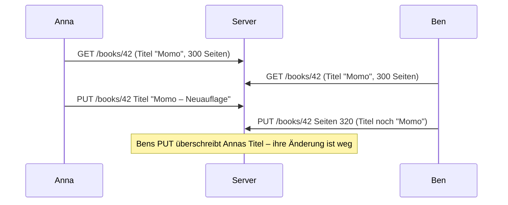

So könnte die Fragestellung lauten:

> Am Empfang und im Büro wird zur selben Zeit dieselbe Reservierung bearbeitet; beide speichern ihre Änderung kurz hintereinander über die REST-API. Beschreibe, welches Problem dabei entsteht, welche Lösungsansätze es dafür gibt und wie du den gewählten Ansatz in JPA und auf HTTP-Ebene umsetzt.

## Schreibübung

Nimm dir **5 Minuten** und schreib deine Antwort in Stichworten. Erst dann weiterlesen.

## Das Wissen dahinter

**Das Problem: Lost Update.**



Keiner bekommt einen Fehler, aber Annas Änderung ist verloren.

**Lösungen:**

| Ansatz | Idee | Vor-/Nachteil |
|---|---|---|
| **Optimistic Locking** | Jeder Datensatz hat eine **Versionsnummer**. Beim Speichern prüft die DB `WHERE id = 42 AND version = 7` und erhöht sie. Hat jemand anderer inzwischen gespeichert, passt die Version nicht → Fehler. | kein Sperren, skaliert gut; der Zweite muss neu laden und nochmal ändern. Standard in Web-Anwendungen. |
| **Pessimistic Locking** | Datensatz beim Lesen **sperren** (`SELECT … FOR UPDATE`), bis man fertig ist. | Konflikte unmöglich, aber andere warten; bei Web-Clients, die „nie zurückkommen“, ungeeignet. |
| **PATCH statt PUT** | Nur geänderte Felder senden. | verringert das Problem, wenn verschiedene Felder geändert werden – löst es nicht bei demselben Feld. |
| „last write wins“ | nichts tun | einfach, aber Datenverlust. |

**In Spring / JPA:**

```java
@Entity
public class Book extends AbstractPersistable<Long> {
    @Version
    private Long version;
    // …
}
```

Hibernate erhöht `version` bei jedem Update und wirft eine `OptimisticLockException` (in Spring: `ObjectOptimisticLockingFailureException`), wenn die Version nicht mehr stimmt.

**Über HTTP:** Der Client bekommt die Version mit (im JSON oder als `ETag`-Header) und schickt sie beim Ändern zurück (im Body oder als `If-Match`-Header). Passt sie nicht, antwortet der Server mit **`409 Conflict`** (bzw. `412 Precondition Failed` bei `If-Match`), und der Client lädt neu.

## Musterantwort

> Wenn zwei Benutzer dasselbe Objekt laden und nacheinander mit PUT speichern, überschreibt der zweite die Änderungen des ersten, ohne es zu merken (**Lost Update**). Bei PUT ist das besonders kritisch, weil immer das ganze Objekt mit dem alten Stand der anderen Felder gesendet wird; PATCH verkleinert das Problem, löst es aber nicht, wenn beide dasselbe Feld ändern.
>
> Die übliche Lösung ist **Optimistic Locking**: Jeder Datensatz bekommt eine Versionsnummer. Beim Speichern wird geprüft, ob die Version noch dieselbe ist wie beim Laden, und sie wird erhöht. Hat inzwischen jemand anderer gespeichert, schlägt das Update fehl; der Server antwortet mit `409 Conflict`, und der Client muss neu laden und die Änderung wiederholen. In JPA reicht dafür ein Feld mit `@Version`; Hibernate wirft dann eine `OptimisticLockException`, die ich im `@RestControllerAdvice` auf `409` abbilde. Die Version wird dem Client im JSON oder als `ETag` mitgegeben und beim PUT/PATCH (bzw. im `If-Match`-Header) zurückgeschickt.
>
> Alternativ gibt es **Pessimistic Locking**: Der Datensatz wird beim Laden gesperrt, bis die Bearbeitung fertig ist. Das verhindert Konflikte, lässt aber andere warten und ist bei Web-Anwendungen mit langen Bearbeitungszeiten ungünstig.

:::pruefung
Checkliste – hast du …
- das Problem beim Namen genannt (**Lost Update**) und erklärt?
- **Optimistic Locking** mit Versionsnummer erklärt?
- **JPA `@Version`** und die Exception genannt?
- die **HTTP-Seite** beschrieben (`409 Conflict`, Version/ETag mitschicken, neu laden)?
- **Pessimistic Locking** als Alternative mit Nachteil genannt?
:::
