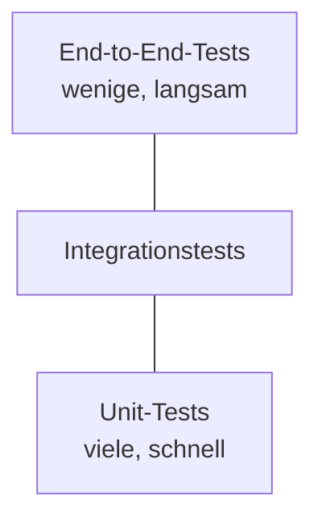

So könnte die Fragestellung lauten:

> Welche Arten von automatisierten Tests kennst du? Erkläre für jede Art, was sie prüft und wie sie grundsätzlich funktioniert, und nenne Werkzeuge, mit denen du sie in deinem Technologiestack schreibst.

Du schreibst in der Matura selbst drei dieser Testarten – du musst sie nur benennen können.

## Schreibübung

Nimm dir **5 Minuten** und schreib deine Antwort in Stichworten. Erst dann weiterlesen.

## Das Wissen dahinter

Die **Testpyramide**: unten viele kleine, schnelle Tests, oben wenige große, langsame.

| Testart | Was wird getestet? | Wie? | In Java / Spring |
|---|---|---|---|
| **Unit-Test** | eine Klasse/Methode **isoliert** | Abhängigkeiten durch **Mocks/Stubs** ersetzt, kein Server, keine DB | JUnit 5, AssertJ, Mockito (`@Mock`, `@InjectMocks`) – **Aufgabe 2** |
| **Integrationstest** | Zusammenspiel mehrerer Teile, z. B. mit echter DB | Teile der Anwendung werden hochgefahren | `@DataJpaTest` (JPA + H2) – **Aufgabe 1**; `@SpringBootTest` |
| **Slice-/Web-Test** | nur die Web-Schicht | Controller mit gemocktem Service, HTTP simuliert | `@WebMvcTest`, MockMvc, `@MockitoBean` – **Aufgabe 3** |
| **End-to-End-Test** | die ganze Anwendung aus Sicht des Benutzers | Browser oder HTTP-Client gegen laufendes System | Playwright, Selenium, REST Assured |
| **Akzeptanztest** | erfüllt die Anwendung die Anforderungen? | Szenarien in Fachsprache | Cucumber (Given/When/Then) |
| **Last-/Performancetest** | Verhalten unter vielen gleichzeitigen Anfragen | simulierte Benutzer | JMeter, Gatling, k6 |
| **Regressionstest** | funktioniert Altes nach Änderungen noch? | alle bestehenden Tests automatisch erneut ausführen | CI-Pipeline (GitHub Actions) |

Zum Aufbau jedes Tests gehört **Arrange – Act – Assert** (Vorbereiten – Ausführen – Prüfen).

## Musterantwort

> Automatisierte Tests werden oft als **Testpyramide** dargestellt: viele schnelle Unit-Tests, weniger Integrationstests, wenige End-to-End-Tests. Jeder Test folgt dem Muster Arrange – Act – Assert.
>
> **Unit-Tests** prüfen eine einzelne Klasse isoliert; Abhängigkeiten werden durch Mocks oder Stubs ersetzt. In Java verwende ich JUnit 5 mit AssertJ (`assertThat(…).isEqualTo(…)`) und Mockito (`@Mock`, `@InjectMocks`, `when(…).thenReturn(…)`), z. B. für die Geschäftslogik im Service. Parametrisierte Tests (`@ParameterizedTest`, `@CsvSource`) decken viele Fälle ab.
>
> **Integrationstests** prüfen das Zusammenspiel mehrerer Komponenten, etwa Entities und Repositories mit einer echten (In-Memory-)Datenbank: in Spring mit `@DataJpaTest`. **Web-Tests** testen nur die Controller-Schicht: `@WebMvcTest` mit MockMvc schickt simulierte HTTP-Anfragen, das Service wird mit `@MockitoBean` ersetzt, geprüft werden Statuscodes und JSON (`jsonPath`). `@SpringBootTest` startet die ganze Anwendung.
>
> **End-to-End-Tests** testen das gesamte System aus Benutzersicht, z. B. mit Playwright im Browser. Darüber hinaus gibt es **Akzeptanztests** (Cucumber), **Last- und Performancetests** (JMeter, Gatling) und **Regressionstests**, bei denen alle Tests nach jeder Änderung automatisch in einer CI-Pipeline laufen.

:::pruefung
Checkliste – hast du …
- mindestens **Unit-, Integrations- und End-to-End-Tests** genannt und unterschieden?
- die **Funktionsweise** erklärt (isoliert mit Mocks / mehrere Teile mit DB / ganzes System)?
- die **Spring-Werkzeuge** genannt (JUnit 5, AssertJ, Mockito, `@DataJpaTest`, `@WebMvcTest` + MockMvc, `@SpringBootTest`)?
- die **Testpyramide** oder Arrange–Act–Assert erwähnt?
- weitere Arten genannt (Last-, Akzeptanz-, Regressionstests, CI)?
:::
